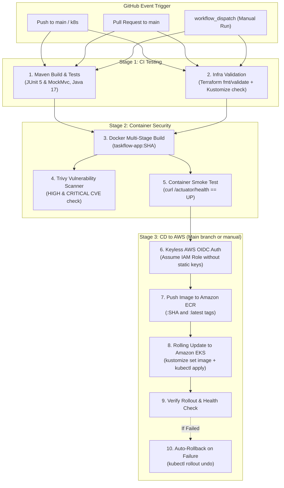

# 🚀 TaskFlow CI/CD Pipeline (GitHub Actions)

This directory contains the automated **Continuous Integration and Continuous Deployment (CI/CD)** pipeline for **TaskFlow**, orchestrated using **GitHub Actions**, **Docker**, **Amazon ECR**, and **Amazon EKS**.

---

## 🏗️ Pipeline Architecture



---

## 📋 Pipeline Jobs Breakdown

| Job | Trigger | Key Steps & Tools |
|---|---|---|
| **`test-and-verify`** | Push & PR | • Sets up Java 17 (Temurin)<br>• Runs `mvn clean verify`<br>• Executes 21 unit & integration tests<br>• Uploads Surefire test reports artifact |
| **`validate-infrastructure`** | Push & PR | • Validates Terraform syntax (`terraform fmt -check`, `terraform validate`)<br>• Validates both `k8s/overlays/local` and `k8s/overlays/eks` with `kubectl kustomize` |
| **`docker-build-and-scan`** | Push & PR | • Multi-stage Docker build with GitHub Actions layer caching<br>• Scans image for CVE vulnerabilities using **Aqua Security Trivy**<br>• Uploads SARIF security scan results to GitHub Code Scanning<br>• Runs ephemeral container locally and verifies `/actuator/health` probe returns `{"status":"UP"}` |
| **`push-to-ecr`** | Push to `main` / `k8s` or manual | • Assumes AWS IAM role via **Keyless GitHub OIDC**<br>• Authenticates Docker to Amazon ECR<br>• Tags and pushes immutable image (`:${{ github.sha }}`) and `:latest` |
| **`deploy-to-eks`** | Push to `main` or manual | • Connects to EKS cluster via `aws eks update-kubeconfig`<br>• Injects immutable SHA image tag into `k8s/overlays/eks`<br>• Executes `kubectl apply -k k8s/overlays/eks`<br>• Monitors `kubectl rollout status` (180s timeout)<br>• **Automatically rolls back** (`kubectl rollout undo`) if rollout fails |

---

## 🔐 Configuring Keyless AWS Authentication (OIDC)

The pipeline uses **OpenID Connect (OIDC)** to securely assume an AWS IAM role without storing permanent, static AWS access keys in GitHub Secrets.

### 1. Provision the OIDC Role with Terraform
The role is already configured in [terraform/github-oidc.tf](file:///c:/Users/Sidharth/Desktop/taskflow-devops/terraform/github-oidc.tf).
Run Terraform to output the role ARN:
```bash
cd terraform
terraform output -raw github_actions_role_arn
```
Example output: `arn:aws:iam::123456789012:role/taskflow-prod-github-actions-role`

### 2. Configure GitHub Repository Secrets & Variables
In your GitHub repository, navigate to **Settings > Secrets and variables > Actions**:

#### Secret:
| Secret Name | Value | Description |
|---|---|---|
| `AWS_ROLE_ARN` | `arn:aws:iam::<ACCOUNT_ID>:role/taskflow-prod-github-actions-role` | The IAM Role ARN for OIDC authentication |

#### Variables (Optional - defaults are provided in workflow):
| Variable Name | Default Value | Description |
|---|---|---|
| `AWS_REGION` | `us-east-1` | AWS region where EKS and ECR reside |
| `EKS_CLUSTER_NAME` | `taskflow-prod-cluster` | Name of the Amazon EKS cluster |
| `ECR_REPOSITORY` | `taskflow-app` | Name of the Amazon ECR repository |

---

## 🛡️ Built-in Resilience & Rollback

If a bad deployment is merged or an unexpected bug prevents pods from passing the `/actuator/health/readiness` probe:
1. Kubernetes prevents traffic from reaching the newly launched pods.
2. `kubectl rollout status` reaches its 180-second timeout and exits with error code 1.
3. The `if: failure()` step triggers:
   ```bash
   kubectl rollout undo deployment/taskflow-app -n taskflow
   ```
4. The deployment is instantly rolled back to the previous stable revision with **zero downtime**.
