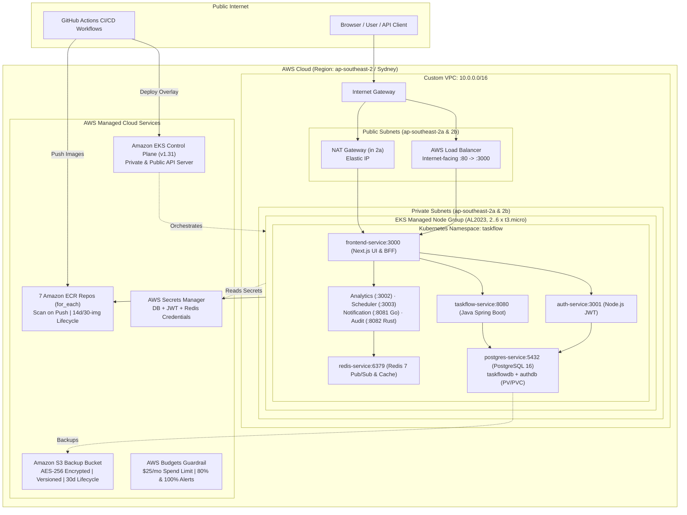

# 🚀 TaskFlow - Polyglot Microservices DevOps Platform

TaskFlow is a production-ready DevOps platform combining a **Java 17 / Spring Boot 3** core task service with **Golang**, **Rust**, **Node.js** microservices, **Redis 7**, **PostgreSQL 16**, and a **Next.js** dashboard UI — engineered with multi-stage non-root Alpine Docker images, Kustomize Kubernetes manifests, Terraform AWS IaC, and GitHub Actions CI/CD.

---

> 📌 **Quick Navigation**: [🧩 Microservices Stack](#-polyglot-microservices-architecture) • [🌐 AWS Cloud Architecture](#-whole-aws-cloud-environment-architecture) • [🤝 10 Manual Handshakes](#-manual-handshakes--required-human-efforts) • [☸️ Local K3s](#option-a-local-k3s-deployment-using-k3d) • [☁️ AWS EKS](#option-b-aws-eks-deployment) • [🚀 CI/CD](.github/README.md) • [🌍 Terraform IaC](terraform/README.md) • [🔧 Troubleshooting](#-comprehensive-troubleshooting-guide)

---

## 🧩 Polyglot Microservices Architecture

| Service | Tech Stack | Port | Docker Base Image | Responsibility |
|---|---|---|---|---|
| **Frontend UI & BFF** (`frontend/`) | Next.js 14 + Tailwind CSS | `3000` | `node:22-alpine` | Modern SaaS Kanban board, service mesh health monitor, runtime BFF proxy |
| **Task Service** (`services/task-service/`) | Java 17 + Spring Boot 3 | `8080` | `eclipse-temurin:17-jre-alpine` | Task CRUD API, OpenAPI/Swagger, Actuator & Prometheus metrics |
| **Auth Service** (`services/auth-service/`) | Node.js 22 + Express | `3001` | `node:22-alpine` | JWT authentication (`crypto.scrypt` + PostgreSQL `authdb`) |
| **Analytics Service** (`services/analytics-service/`) | Node.js 22 + Express | `3002` | `node:22-alpine` | Real-time completion metrics with Redis TTL caching (`REDIS_HIT` / `LIVE_COMPUTE`) |
| **Scheduler Service** (`services/scheduler-service/`) | Node.js 22 + Express | `3003` | `node:22-alpine` | Periodic task sweep & manual trigger publishing events to Redis Pub/Sub |
| **Notification Service** (`services/notification-service/`) | Golang 1.22 + `go-redis` | `8081` | `alpine:3.20` | Subscribes to Redis `taskflow:events` Pub/Sub & serves alert feed |
| **Audit Logs Service** (`services/audit-service/`) | Rust + Axum + Tokio | `8082` | `alpine:3.20` | Immutable append-only audit trail (`/data/audit.jsonl` volume) |
| **Redis** (`redis:7-alpine`) | Redis 7 | `6379` | `redis:7-alpine` | Pub/Sub event bus, analytics cache & notification persistence |
| **PostgreSQL** (`postgres:16-alpine`) | PostgreSQL 16 | `5432` | `postgres:16-alpine` | Relational DB hosting `taskflowdb` (tasks) & `authdb` (auth users) with PV/PVC |

---

## 📋 Features

- **Core API (`services/task-service/`)**: Spring Boot 3.3.x, Spring Data JPA, Bean Validation, PostgreSQL 16 / H2, Actuator & Prometheus (`/actuator/prometheus`), Swagger UI (`/swagger-ui.html`)
- **Docker Best Practices**: Multi-stage builds, dependency layer caching, `.dockerignore` files, non-root users (`10001` / `node`), lightweight Alpine images, and container `HEALTHCHECK` probes
- **Kubernetes Architecture**:
  - Declarative Kustomize setup (`base/` + `overlays/{local,eks}`) covering Redis, Postgres, all 6 backend microservices, and Next.js Frontend
  - Zero-downtime rolling updates with `readinessProbe` and `livenessProbe`
  - Horizontal Pod Autoscaler (HPA) & Pod Disruption Budget (PDB)

---

## 📁 Project Structure

```text
taskflow-devops/
├── .github/
│   ├── README.md                                # GitHub Actions CI/CD pipelines documentation
│   └── workflows/
│       ├── ci-task-service.yml                  # Java Spring Boot CI + Trivy + Smoke test
│       ├── ci-node-services.yml                 # Matrix CI for Auth, Analytics & Scheduler
│       ├── ci-go-notification.yml               # Go Notification Service CI
│       ├── ci-rust-audit.yml                    # Rust Audit Logs Service CI
│       ├── ci-frontend.yml                      # Next.js TypeScript & Standalone Docker CI
│       ├── ci-infra-k8s.yml                     # Terraform, Kustomize & Compose validation CI
│       └── cd-deploy.yml                        # Docker Hub push & AWS EKS deploy CD
├── services/
│   ├── task-service/                            # Java 17 Spring Boot Task API (:8080)
│   │   ├── pom.xml
│   │   ├── Dockerfile
│   │   ├── .env.example
│   │   └── src/
│   ├── auth-service/                            # Node.js JWT auth service (:3001)
│   ├── analytics-service/                       # Node.js analytics + Redis cache (:3002)
│   ├── scheduler-service/                       # Node.js cron reminder scheduler (:3003)
│   ├── notification-service/                    # Golang Redis Pub/Sub notifications (:8081)
│   └── audit-service/                           # Rust Axum append-only audit logs (:8082)
├── frontend/                                    # Next.js 14 Dashboard UI & BFF (:3000)
├── k8s/
│   ├── README.md                                # Comprehensive Kubernetes architecture & guide
│   ├── aws.md                                   # AWS EKS & ECS Sydney deployment guide
│   ├── base/                                    # Cloud-agnostic base Kubernetes manifests
│   │   ├── namespace.yaml                       # taskflow namespace
│   │   ├── configmap.yaml                       # App config (ports, DB URL, actuator)
│   │   ├── secret.yaml                          # DB credentials
│   │   ├── postgres-service.yaml                # ClusterIP service for PostgreSQL (port 5432)
│   │   ├── postgres-pvc.yaml                    # PersistentVolumeClaim (1Gi RWO) for PostgreSQL
│   │   ├── postgres-statefulset.yaml            # PostgreSQL 16 StatefulSet (mounts postgres-pvc)
│   │   ├── redis.yaml                           # Redis 7 Deployment + Service (port 6379)
│   │   ├── app-deployment.yaml                  # Spring Boot Task API deployment
│   │   ├── app-service.yaml                     # Internal service (port 8080)
│   │   ├── microservices.yaml                   # Deployments & Services for Go, Rust & Node.js services
│   │   ├── frontend.yaml                        # Next.js UI & BFF Deployment + Service (port 3000)
│   │   ├── hpa.yaml                             # Autoscaler
│   │   ├── pdb.yaml                             # PodDisruptionBudget
│   │   └── kustomization.yaml                   # Base Kustomize definition
│   └── overlays/
│       ├── local/                               # Local K3s / K3d overlay (PV/PVCs, Ingress, NodePorts)
│       └── eks/                                 # AWS EKS production overlay (GP3 PVC + LoadBalancer -> Frontend)
├── terraform/
│   ├── README.md                                # Complete Terraform infrastructure guide
│   ├── bootstrap/                               # Remote state S3 bucket & DynamoDB lock table
│   ├── modules/                                 # Reusable VPC, ECR, and EKS modules
│   │   ├── vpc/                                 # Multi-AZ VPC, subnets, NAT Gateway, IGW
│   │   ├── ecr/                                 # Container registry with lifecycle scanning
│   │   └── eks/                                 # EKS Cluster, node group, EBS CSI driver
│   ├── {main,variables,outputs,versions}.tf     # Core infrastructure orchestration
│   ├── github-oidc.tf                           # Optional GitHub Actions OIDC IAM role
│   ├── secrets.tf                               # AWS Secrets Manager DB credentials
│   ├── backup.tf                                # S3 automated backup bucket & lifecycle
│   ├── budget.tf                                # AWS budget & cost guardrail alerts
│   └── terraform.tfvars.example                 # Variables configuration template
├── plan/
│   └── TaskFlow-DevOps-LLM-Implementation-Plan.md
├── docker-compose.yml                           # Complete 9-container stack (Frontend, 6 Services, Redis, Postgres)
├── Dockerfile                                   # Root Dockerfile shortcut
└── README.md
```

---

## ⚙️ Environment Configuration

Configuration is loaded from environment variables with sensible defaults defined in [application.yml](file:///c:/Users/Sidharth/Desktop/taskflow-devops/services/task-service/src/main/resources/application.yml):

| Variable | Local Default (H2) | Docker Compose / Kubernetes (PostgreSQL) | Description |
|---|---|---|---|
| `SERVER_PORT` | `8080` | `8080` | Tomcat HTTP listen port |
| `SPRING_DATASOURCE_URL` | `jdbc:h2:mem:taskflowdb;...` | `jdbc:postgresql://postgres-service:5432/taskflowdb` | JDBC connection string |
| `SPRING_DATASOURCE_USERNAME` | `sa` | `taskflow` | Database user |
| `SPRING_DATASOURCE_PASSWORD` | `""` | `taskflow_secure_pwd_2026` | Database password |
| `SPRING_DATASOURCE_DRIVER_CLASS_NAME`| `org.h2.Driver` | `org.postgresql.Driver` | JDBC driver class |
| `SPRING_JPA_HIBERNATE_DDL_AUTO` | `update` | `update` | Schema migration mode |
| `MANAGEMENT_ENDPOINTS_WEB_EXPOSURE_INCLUDE` | `health,info,metrics,prometheus` | `health,info,metrics,prometheus` | Actuator endpoints |

---

## 💻 Local Development

### 1. Run with Maven (In-Memory H2)
```bash
cd services/task-service
mvn spring-boot:run
```
- API & Swagger UI: [http://localhost:8080/swagger-ui.html](http://localhost:8080/swagger-ui.html)
- H2 Console: [http://localhost:8080/h2-console](http://localhost:8080/h2-console) (JDBC URL: `jdbc:h2:mem:taskflowdb`, User: `sa`, Password: empty)

### 2. Run Automated Tests
```bash
cd services/task-service
mvn test
```

---

## 🐳 Running with Docker & Docker Compose

Docker Compose provisions the complete **9-container polyglot microservices stack** (`postgres:16-alpine`, `redis:7-alpine`, Java `task-service`, Node.js `auth`/`analytics`/`scheduler`, Golang `notification`, Rust `audit`, and Next.js `frontend`):

```bash
# Build and start all 9 containers in detached mode
docker compose up --build -d

# Check status and health checks across all services
docker compose ps

# Open the Next.js Control Plane UI in your browser:
# http://localhost:3000
# Demo login: admin@taskflow.dev / admin123

# Follow logs across services
docker compose logs -f frontend task-service auth-service notification-service audit-service

# Tear down the stack and remove persistent volumes
docker compose down -v
```

---

## ☸️ Kubernetes Deployment

### Option A: Local K3s Deployment (using `k3d`)

[k3d](https://k3d.io) runs lightweight K3s clusters inside Docker containers. It is fast, lightweight, and ideal for local Kubernetes testing on Windows, macOS, or Linux.

#### 1. Prerequisites
- Docker Desktop or Docker Engine running
- `kubectl` installed
- `k3d` installed (`choco install k3d` or `winget install k3d` on Windows, or `brew install k3d` on macOS)

#### 2. Create the K3s Cluster
Create a cluster named `taskflow` mapping NodePort `30080` to your host:
```bash
k3d cluster create taskflow \
  --api-port 6550 \
  -p "30080:30080@server:0" \
  -p "8081:80@loadbalancer"
```

> **Windows Tip**: If `kubectl` commands fail with a host timeout, see [Troubleshooting #1](#1-k3d-api-server-timeout-on-windows-hostdockerinternal).

#### 3. Build & Import Image into K3d
Build the Docker image locally and import it directly into the `k3d` cluster without needing a remote registry:
```bash
# Build all 7 container images
docker build -t taskflow-app:latest ./services/task-service
docker build -t taskflow-auth-service:latest ./services/auth-service
docker build -t taskflow-analytics-service:latest ./services/analytics-service
docker build -t taskflow-scheduler-service:latest ./services/scheduler-service
docker build -t taskflow-notification-service:latest ./services/notification-service
docker build -t taskflow-audit-service:latest ./services/audit-service
docker build -t taskflow-frontend:latest ./frontend

# Import the images into the k3d cluster
k3d image import \
  taskflow-app:latest \
  taskflow-auth-service:latest \
  taskflow-analytics-service:latest \
  taskflow-scheduler-service:latest \
  taskflow-notification-service:latest \
  taskflow-audit-service:latest \
  taskflow-frontend:latest \
  -c taskflow
```

#### 4. Deploy using Kustomize
Deploy the complete stack via the local overlay:
```bash
kubectl apply -k k8s/overlays/local
```

#### 5. Verify the Deployment
```bash
# Check all resources (including PersistentVolumes & PersistentVolumeClaims)
kubectl get all,pv,pvc,hpa,pdb -n taskflow

# Wait for application pods to be fully ready
kubectl wait --namespace taskflow --for=condition=ready pod -l app=taskflow-app --timeout=90s
```

#### 6. Access Application Endpoints
- **Next.js Control Plane UI**: [http://localhost:30088](http://localhost:30088)
- **Swagger UI**: [http://localhost:30080/swagger-ui.html](http://localhost:30080/swagger-ui.html)
- **Application Info**: [http://localhost:30080/api/info](http://localhost:30080/api/info)
- **Actuator Health**: [http://localhost:30080/actuator/health](http://localhost:30080/actuator/health)
- **Prometheus Metrics**: [http://localhost:30080/actuator/prometheus](http://localhost:30080/actuator/prometheus)

#### 7. Teardown
```bash
kubectl delete -k k8s/overlays/local
k3d cluster delete taskflow
```

---

### Option B: AWS EKS Deployment (`ap-southeast-2` Sydney)

> 📘 **Full AWS Step-by-Step Guide**: See [**`k8s/aws.md`**](file:///c:/Users/Sidharth/Desktop/taskflow-devops/k8s/aws.md) for complete instructions covering IAM CLI setup, custom VPC provisioning, Free-Tier `t3.micro` EKS & ECS Fargate paths, Docker Hub deployment, and safe teardown.

#### 1. Prerequisites
- AWS CLI configured (`aws configure` targeting `ap-southeast-2`)
- `terraform` (`>= 1.5.0`) and `kubectl` installed

#### 2. Provision VPC, 7 ECR Repositories & EKS via Terraform
```bash
cd terraform
terraform init
terraform apply -auto-approve
aws eks update-kubeconfig --region ap-southeast-2 --name taskflow-prod-cluster
```

#### 3. Build & Push All 7 Images (Docker Hub or Amazon ECR)
```bash
# Example using Docker Hub (matches k8s/overlays/eks/kustomization.yaml)
export DOCKER_USER="sidharthhhh"
docker build --platform linux/amd64 -t ${DOCKER_USER}/taskflow-app:latest ./services/task-service
docker build --platform linux/amd64 -t ${DOCKER_USER}/taskflow-auth-service:latest ./services/auth-service
docker build --platform linux/amd64 -t ${DOCKER_USER}/taskflow-analytics-service:latest ./services/analytics-service
docker build --platform linux/amd64 -t ${DOCKER_USER}/taskflow-scheduler-service:latest ./services/scheduler-service
docker build --platform linux/amd64 -t ${DOCKER_USER}/taskflow-notification-service:latest ./services/notification-service
docker build --platform linux/amd64 -t ${DOCKER_USER}/taskflow-audit-service:latest ./services/audit-service
docker build --platform linux/amd64 -t ${DOCKER_USER}/taskflow-frontend:latest ./frontend
```

#### 4. Deploy & Retrieve Public Frontend LoadBalancer URL
```bash
kubectl apply -k k8s/overlays/eks
kubectl get svc frontend-service -n taskflow -w
```
Once `EXTERNAL-IP` resolves (e.g., `xxx.ap-southeast-2.elb.amazonaws.com`), open **`http://<EXTERNAL-IP>`** in your browser to access the Next.js Control Plane UI!

#### 5. Teardown (Always delete K8s LoadBalancers before `terraform destroy`)
```bash
kubectl delete -k k8s/overlays/eks
cd terraform && terraform destroy -auto-approve
```

---

## 🌐 Whole AWS Cloud Environment Architecture



---

## 🤝 Manual Handshakes & Required Human Efforts

While Terraform, Docker, and GitHub Actions automate over 95% of provisioning, real-world cloud security and account boundaries require **10 critical manual handshakes**. Here is the complete operational checklist:

| # | Handshake Touchpoint | Why Human Effort is Mandatory | Exact Action Required | Location / Command |
|---|---|---|---|---|
| **1** | **AWS CLI & Credentials** | IaC cannot invent cloud permissions; it requires human authentication. | Run `aws configure` with an IAM user with EKS, VPC, EC2, IAM, ECR, S3, Secrets Manager, and Budgets permissions. | Local Terminal (`aws configure`) |
| **2** | **Remote State Bootstrap *(Optional)*** | Local Terraform state is default; S3 remote state requires the bucket to exist first. | *(Optional)* Run `cd terraform/bootstrap && terraform apply` and enable `backend "s3"` in `versions.tf`. | `terraform/bootstrap/` |
| **3** | **Variable Customization** | Real emails, private repositories, and AWS regions must never be hardcoded in Git. | Copy `terraform.tfvars.example` to `terraform.tfvars` and verify `budget_alert_email`, `github_repo`, and `aws_region` (`ap-southeast-2`). | `terraform/terraform.tfvars` |
| **4** | **AWS Budget Email Confirmation** | AWS SNS anti-spam compliance requires human verification before sending cost breach alerts. | Open your email inbox (`budget_alert_email`) and **click "Confirm Subscription"** in the automated AWS Budgets email. | Personal Email Inbox |
| **5** | **GitHub Actions & Docker Hub Secrets** | GitHub Actions runs externally and needs credentials to push images and deploy. | Configure `DOCKERHUB_USERNAME`, `DOCKERHUB_TOKEN`, and `AWS_ACCESS_KEY_ID`/`AWS_SECRET_ACCESS_KEY` (or `AWS_ROLE_ARN`). | **GitHub Repo Settings > Secrets & variables > Actions** |
| **6** | **Local Kubeconfig Context** | Your local machine's `kubectl` CLI must be pointed to the new cloud cluster endpoint. | Run `aws eks update-kubeconfig --region ap-southeast-2 --name taskflow-prod-cluster` to establish cluster access. | Local Terminal (`aws eks update-kubeconfig`) |
| **7** | **AWS Load Balancer Exposure** | `frontend-service` uses EKS's in-tree LoadBalancer controller (`aws-load-balancer-scheme: internet-facing`). | No extra Helm controller needed; verify public subnets carry `kubernetes.io/role/elb = 1` (created by `modules/vpc`). | `k8s/overlays/eks/frontend-service-patch.yaml` |
| **8** | **External Secrets Operator** | Production database passwords must never be stored in plain text inside Git or Kubernetes manifests. | Install External Secrets Operator (or sync `taskflow/prod/db-credentials` into `secret.yaml`) before starting app pods. | EKS Cluster / Secrets Manager |
| **9** | **GitHub Deployment Approval Gate** | Production releases should be gated behind human authorization in enterprise environments. | In GitHub Settings, create environment `production` with required reviewers so deployments pause for your approval. | **GitHub Repo Settings > Environments > production** |
| **10**| **Teardown Sequence Order** | Dynamic NLBs and EBS ENIs created by Kubernetes will deadlock VPC deletion if destroyed out of order. | **Always delete Kubernetes services first** (`kubectl delete -k k8s/overlays/eks`), wait 2–3 minutes, and *then* run `terraform destroy`. | Terminal (`kubectl delete` -> `terraform destroy`) |

---

### Step-by-Step Instructions for Each Handshake

### 1. AWS CLI Credentials & Account Identity Handshake
- **Why Manual**: Terraform and AWS CLI cannot invent cloud permissions; they require authenticated human credentials.
- **Action Required**:
  ```bash
  aws configure
  # Enter AWS Access Key ID, Secret Access Key, default region (ap-southeast-2)
  
  # Verify active account identity
  aws sts get-caller-identity
  ```
- **Permission Check**: Ensure your IAM identity possesses permissions for VPC, EC2, EKS, IAM, ECR, S3, Secrets Manager, and Budgets.

---

### 2. Remote State Bootstrap Handshake *(Optional)*
- **Why Manual**: Local Terraform state is enabled by default in `terraform/versions.tf` for fast solo setup. If you want shared remote S3 state instead, provision the S3 bucket and DynamoDB lock table first:
  ```bash
  cd terraform/bootstrap
  terraform init
  terraform apply
  ```
- **Output Handshake**: Note `state_bucket_name` (e.g. `taskflow-prod-tfstate-666952271651`) and uncomment `backend "s3"` in `terraform/versions.tf`.

---

### 3. Variable Configuration Handshake (`terraform.tfvars`)
- **Why Manual**: Real-world identifiers (your personal email, region, repository path) must never be hardcoded into public repositories.
- **Action Required**:
  ```bash
  cd terraform
  cp terraform.tfvars.example terraform.tfvars
  ```
- Edit `terraform.tfvars` with:
  - `budget_alert_email = "your-actual-email@example.com"`
  - `github_repo = "sidharthhhh/taskflow-devops"`
  - `aws_region = "ap-southeast-2"`

---

### 4. AWS Budget Email Confirmation Handshake
- **Why Manual**: AWS SNS / Budgets enforces anti-spam compliance by requiring explicit human email verification.
- **Action Required**:
  1. After running `terraform apply`, open your email inbox (`budget_alert_email`).
  2. Find the automated email from **AWS Notifications / AWS Budgets**.
  3. **Click "Confirm Subscription"**. Until clicked, AWS will suppress threshold breach emails!

---

### 5. GitHub Actions Authentication & Docker Hub Secrets Handshake
- **Why Manual**: GitHub Actions runs outside AWS and Docker Hub and needs credentials to push images and deploy.
- **Action Required**:
  In your GitHub repository, open **Settings > Secrets and variables > Actions**:
  - **Secrets**: `DOCKERHUB_USERNAME`, `DOCKERHUB_TOKEN`, and either `AWS_ROLE_ARN` (if OIDC is allowed) or `AWS_ACCESS_KEY_ID` + `AWS_SECRET_ACCESS_KEY` (when an AWS Organization SCP blocks OIDC creation).
  - **Variables**: `AWS_REGION=ap-southeast-2`, `EKS_CLUSTER_NAME=taskflow-prod-cluster`, `DEPLOY_ENABLED=true` (when ready for CD).

---

### 6. Local Kubeconfig Connection Handshake
- **Why Manual**: Your local machine's `kubectl` CLI does not automatically know where your new cloud cluster lives.
- **Action Required**:
  ```bash
  aws eks update-kubeconfig --region ap-southeast-2 --name taskflow-prod-cluster
  kubectl get nodes -o wide
  ```

---

### 7. AWS Load Balancer Exposure *(Automatic via In-Tree Controller)*
- **Note**: `k8s/overlays/eks/frontend-service-patch.yaml` uses EKS's built-in in-tree AWS LoadBalancer integration (`service.beta.kubernetes.io/aws-load-balancer-scheme: "internet-facing"`), so **no extra Helm Load Balancer Controller installation is required**.
- Simply ensure your VPC public subnets carry the `"kubernetes.io/role/elb" = "1"` tag (already handled by `terraform/modules/vpc`).

---

### 8. External Secrets Operator / DB Credentials Sync Handshake
- **Why Manual**: Production database passwords should never be stored in plain text inside Git or Kubernetes manifests.
- **Action Required**:
  - Terraform generates a random 24-character password in AWS Secrets Manager (`taskflow/prod/db-credentials`).
  - Install **External Secrets Operator** (`helm install external-secrets external-secrets/external-secrets -n kube-system`) or inject the credentials into Kubernetes `secret.yaml` before deployment so Spring Boot can authenticate.

---

### 9. GitHub Protected Environment Deployment Gate (Optional but Recommended)
- **Why Manual**: In production enterprise environments, automatic pushes to production should be gated behind human authorization.
- **Action Required**:
  1. In GitHub, open **Settings > Environments > New environment > `production`**.
  2. Check **Required reviewers** and assign yourself or your team lead.
  3. When CI finishes testing, GitHub Actions will pause and wait for you to click **"Review deployments -> Approve and deploy"**.

---

### 10. Destruction Order Handshake (Preventing VPC Deadlocks)
- **Why Manual**: When an AWS Network Load Balancer or EBS volume is created dynamically by Kubernetes, AWS attaches Elastic Network Interfaces (ENIs) inside your VPC subnets. If you run `terraform destroy` first, the VPC deletion will fail with `DependencyViolation`!
- **Action Required (Strict Destruction Sequence)**:
  ```bash
  # Step 1: ALWAYS delete Kubernetes services and StatefulSets first:
  kubectl delete -k k8s/overlays/eks

  # Step 2: Wait 2-3 minutes for AWS to release Load Balancers and ENIs

  # Step 3: Now cleanly destroy AWS infrastructure:
  cd terraform
  terraform destroy -auto-approve

  # Step 4: (Optional) Destroy bootstrap state storage:
  cd bootstrap
  terraform destroy -auto-approve
  ```

---

## 🔧 Comprehensive Troubleshooting Guide

This section covers common operational hurdles, real root causes, and verified fixes.

### 1. K3d API Server Timeout on Windows (`host.docker.internal`)
- **Symptom**: `kubectl get pods` hangs and outputs:
  ```text
  Unable to connect to the server: dial tcp: lookup host.docker.internal: no such host
  ```
  or times out when connecting to `https://host.docker.internal:<port>`.
- **Root Cause**: On Windows Docker Desktop, `host.docker.internal` in the generated kubeconfig can resolve to a physical LAN/Wi-Fi adapter IP instead of loopback (`127.0.0.1`), causing network route packet drops.
- **Fix**: Update the cluster server address in your kubeconfig to loopback `127.0.0.1`:
  ```powershell
  # Find your k3d API server port
  docker ps --filter "name=k3d-taskflow-server-0" --format "{{.Ports}}"

  # Update the cluster endpoint to 127.0.0.1 (replace 6550 with your port if different)
  kubectl config set-cluster k3d-taskflow --server=https://127.0.0.1:6550 --insecure-skip-tls-verify=true
  ```

---

### 2. PostgreSQL Pod Fails on Volume Mount (`lost+found`)
- **Symptom**: The PostgreSQL pod crashes with logs:
  ```text
  initdb: directory "/var/lib/postgresql/data" exists but is not empty
  It contains a lost+found directory, perhaps due to it being a mount point.
  ```
- **Root Cause**: When Kubernetes attaches a PersistentVolume (EBS on EKS or local-path on K3s), Linux creates a `lost+found` directory at the mount root. PostgreSQL refuses to run `initdb` on a non-empty directory.
- **Fix**: Direct PostgreSQL to use a sub-directory by setting `PGDATA` in [postgres-statefulset.yaml](file:///c:/Users/Sidharth/Desktop/taskflow-devops/k8s/base/postgres-statefulset.yaml):
  ```yaml
  env:
    - name: PGDATA
      value: /var/lib/postgresql/data/pgdata
  ```

---

### 3. Application Pod CrashLoopBackOff during Cold Start
- **Symptom**: Application pods restart 3–5 times before stabilizing, logging:
  ```text
  org.postgresql.util.PSQLException: Connection to postgres-service:5432 refused
  ```
- **Root Cause**: Kubernetes schedules both the app deployment and PostgreSQL StatefulSet simultaneously. Spring Boot starts in under 5 seconds and fails immediately because PostgreSQL is still running its initial database initialization script.
- **Fix**: We included a `wait-for-postgres` initContainer in [app-deployment.yaml](file:///c:/Users/Sidharth/Desktop/taskflow-devops/k8s/base/app-deployment.yaml). It uses `busybox` and `nc` to pause the app pod until port 5432 is actively accepting connections:
  ```yaml
  initContainers:
    - name: wait-for-postgres
      image: busybox:1.36
      command: ['sh', '-c', 'until nc -z -w 2 postgres-service 5432; do echo "Waiting for PostgreSQL..."; sleep 2; done;']
  ```

---

### 4. Hibernate 6 Enum Type Error on PostgreSQL (`ERROR: type "enum" does not exist`)
- **Symptom**: Spring Boot startup fails on PostgreSQL with:
  ```text
  org.hibernate.tool.schema.spi.CommandAcceptanceException: Error executing DDL:
  create table tasks (..., status enum ('TODO','IN_PROGRESS','DONE'))
  Caused by: org.postgresql.util.PSQLException: ERROR: type "enum" does not exist
  ```
- **Root Cause**: If `spring.jpa.database-platform` is hardcoded to `org.hibernate.dialect.H2Dialect` in `application.yml`, Hibernate produces MySQL/H2 DDL syntax that PostgreSQL rejects.
- **Fix**: 
  1. Add `@JdbcTypeCode(SqlTypes.VARCHAR)` above enum fields in [Task.java](file:///c:/Users/Sidharth/Desktop/taskflow-devops/services/task-service/src/main/java/com/taskflow/model/Task.java):
     ```java
     @Enumerated(EnumType.STRING)
     @JdbcTypeCode(SqlTypes.VARCHAR)
     @Column(nullable = false, length = 50)
     private TaskStatus status;
     ```
  2. Remove explicit `database-platform` from `application.yml` so Hibernate 6 auto-detects `PostgreSQLDialect` from the JDBC connection.

---

### 5. `ImagePullBackOff` / `ErrImagePull` on Local K3s/K3d
- **Symptom**: Pod status remains `ImagePullBackOff` or `ErrImagePull`.
- **Root Cause**: The local cluster runtime cannot find `taskflow-app:latest` because it is in your host Docker cache, not inside the K3s container runtime.
- **Fix**:
  1. Import the image into k3d:
     ```bash
     k3d image import taskflow-app:latest -c taskflow
     ```
  2. Ensure `imagePullPolicy: IfNotPresent` is configured in `app-deployment.yaml`.

---

### 6. Inspecting PostgreSQL Databases (`taskflowdb` & `authdb`) inside K8s
To debug data persistence or inspect records directly:
```bash
# Open an interactive psql session in the postgres-0 pod
kubectl exec -it -n taskflow postgres-0 -- psql -U taskflow -d taskflowdb

# Useful psql commands:
\l                   # List databases (taskflowdb & authdb)
\dt                  # List tables in taskflowdb
SELECT * FROM tasks; # View all task rows
\c authdb            # Switch to authdb
SELECT email, name, role FROM auth_users;
\q                   # Exit
```

---

### 7. Debugging Failed Pods & Viewing Container Logs
```bash
# View logs of the running app pods
kubectl logs -n taskflow -l app=taskflow-app -f

# View logs of the init container if a pod is stuck in Init:0/1
kubectl logs -n taskflow <pod-name> -c wait-for-postgres

# Describe pod events (check probe failures, scheduling errors, or OOMKilled)
kubectl describe pod -n taskflow <pod-name>

# Check recent namespace events
kubectl get events -n taskflow --sort-by='.metadata.creationTimestamp'
```

---

## 📡 API Testing & Examples

Test the endpoints using PowerShell (`Invoke-RestMethod`) or `curl`.

*(Replace port `30080` with `8080` if running locally without K3s)*

### 1. GET /api/info
```powershell
Invoke-RestMethod -Uri "http://localhost:30080/api/info" | ConvertTo-Json
```

### 2. POST /api/tasks (Create Task)
```powershell
$task = @{
    title = "Complete Kubernetes Setup"
    description = "Deploy TaskFlow to K3s and AWS EKS"
    status = "IN_PROGRESS"
} | ConvertTo-Json

Invoke-RestMethod -Uri "http://localhost:30080/api/tasks" -Method Post -ContentType "application/json" -Body $task | ConvertTo-Json
```

### 3. GET /api/tasks (List All)
```powershell
Invoke-RestMethod -Uri "http://localhost:30080/api/tasks" | ConvertTo-Json
```

### 4. GET /api/tasks?status=IN_PROGRESS (Filter by Status)
```powershell
Invoke-RestMethod -Uri "http://localhost:30080/api/tasks?status=IN_PROGRESS" | ConvertTo-Json
```

### 5. PUT /api/tasks/{id} (Update Task)
```powershell
$update = @{
    title = "Complete Kubernetes Setup"
    description = "Deploy TaskFlow to K3s and AWS EKS - All pods green!"
    status = "DONE"
} | ConvertTo-Json

Invoke-RestMethod -Uri "http://localhost:30080/api/tasks/1" -Method Put -ContentType "application/json" -Body $update | ConvertTo-Json
```

### 6. DELETE /api/tasks/{id} (Delete Task)
```powershell
Invoke-RestMethod -Uri "http://localhost:30080/api/tasks/1" -Method Delete
```

---

## 📊 Health & Metrics Endpoints

| Endpoint | Purpose | Description |
|---|---|---|
| `GET /actuator/health` | Overall Health | Status of database connection, disk space, and application |
| `GET /actuator/health/liveness` | K8s Liveness Probe | Verifies if the JVM process is alive and responsive |
| `GET /actuator/health/readiness`| K8s Readiness Probe | Verifies database connectivity before routing traffic |
| `GET /actuator/prometheus` | Metrics Scraping | Full Prometheus exposition format metrics for Grafana / Prometheus |
| `GET /swagger-ui.html` | Interactive Docs | OpenAPI 3 visual playground to test all endpoints |
