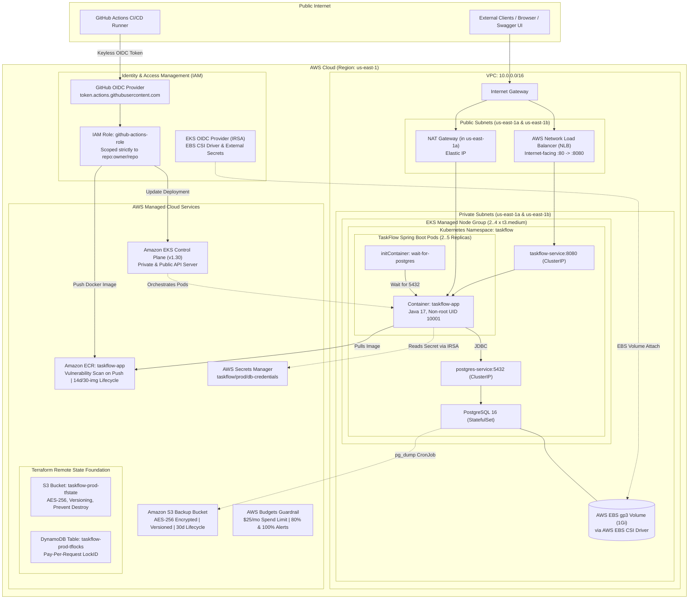

# 🚀 TaskFlow - DevOps-Ready To-Do List REST API

TaskFlow is a production-grade To-Do list REST API built with **Java 17** and **Spring Boot 3.3.x**. It is engineered for containerization and Kubernetes orchestration with zero-downtime rolling updates, PostgreSQL persistence, Prometheus metrics, health probes, and automated scaling.

---

> 📌 **Quick Navigation**: [🌐 AWS Cloud Architecture](#-whole-aws-cloud-environment-architecture) • [🤝 10 Manual Handshakes](#-manual-handshakes--required-human-efforts) • [☸️ Local K3s](#option-a-local-k3s-deployment-using-k3d) • [☁️ AWS EKS](#option-b-aws-eks-deployment) • [🚀 CI/CD](.github/README.md) • [🌍 Terraform IaC](terraform/README.md) • [🔧 Troubleshooting](#-comprehensive-troubleshooting-guide)

---

## 📋 Features

- **Framework**: Spring Boot 3.3.x, Spring Data JPA, Bean Validation
- **Database**: PostgreSQL 16 (production / k8s / compose) & H2 in-memory (local dev / automated testing)
- **Observability**: Spring Boot Actuator with `/actuator/health` (liveness & readiness) and `/actuator/prometheus` metrics export
- **API Documentation**: OpenAPI 3 / Swagger UI (`/swagger-ui.html`)
- **Containerization**: Multi-stage distroless-style Eclipse Temurin 17 JRE Docker image with non-root security (`uid: 10001`) and JVM container cgroup memory limits
- **Kubernetes Architecture**:
  - Declarative Kustomize setup (`base/` + `overlays/{local,eks}`)
  - Zero-downtime rolling updates with `readinessProbe` and `livenessProbe`
  - Database startup synchronization via `wait-for-postgres` initContainer
  - StatefulSet with PersistentVolumeClaim for PostgreSQL persistence (`PGDATA` safe)
  - Horizontal Pod Autoscaler (HPA) targeting 70% CPU and 80% Memory
  - Pod Disruption Budget (PDB) guaranteeing `minAvailable: 1`
  - Graceful pod termination with 20s drain period

---

## 📁 Project Structure

```text
taskflow-devops/
├── .github/
│   ├── README.md                                # GitHub Actions CI/CD pipeline documentation
│   └── workflows/
│       └── ci-cd.yml                            # Multi-stage CI/CD workflow (Test, Scan, ECR, EKS)
├── app/
│   ├── pom.xml                                  # Maven dependencies & build configuration
│   ├── Dockerfile                               # Multi-stage optimized application container
│   ├── .env.example                             # Environment variable template
│   └── src/
│       ├── main/
│       │   ├── java/com/taskflow/
│       │   │   ├── TaskflowApplication.java     # Spring Boot application entrypoint
│       │   │   ├── controller/                  # REST controllers (/api/tasks, /api/info)
│       │   │   ├── service/                     # Transactional business logic
│       │   │   ├── repository/                  # Spring Data JPA repository
│       │   │   ├── model/                       # Task entity, request/response DTOs, Enums
│       │   │   ├── exception/                   # Global exception handler & error response
│       │   │   └── config/                      # OpenAPI & Swagger UI configuration
│       │   └── resources/
│       │       └── application.yml              # Central configuration with env overrides
│       └── test/                                # JUnit 5 & MockMvc integration tests
├── k8s/
│   ├── README.md                                # Comprehensive Kubernetes architecture & guide
│   ├── base/                                    # Cloud-agnostic base Kubernetes manifests
│   │   ├── namespace.yaml                       # taskflow namespace
│   │   ├── configmap.yaml                       # App config (ports, DB URL, actuator)
│   │   ├── secret.yaml                          # DB credentials (base64 encoded)
│   │   ├── postgres-service.yaml                # ClusterIP service for PostgreSQL (port 5432)
│   │   ├── postgres-statefulset.yaml            # StatefulSet with 1Gi volumeClaimTemplate
│   │   ├── app-deployment.yaml                  # 2-replica deployment with initContainer & probes
│   │   ├── app-service.yaml                     # Internal service (port 8080)
│   │   ├── hpa.yaml                             # Autoscaler (min 2, max 5 pods)
│   │   ├── pdb.yaml                             # PodDisruptionBudget (minAvailable: 1)
│   │   └── kustomization.yaml                   # Base Kustomize definition
│   └── overlays/
│       ├── local/                               # Local K3s / K3d overlay
│       │   ├── service-patch.yaml               # NodePort 30080 exposure
│       │   └── kustomization.yaml
│       └── eks/                                 # AWS EKS production overlay
│           ├── service-patch.yaml               # AWS Network Load Balancer (NLB) annotations
│           └── kustomization.yaml
├── terraform/
│   ├── README.md                                # Complete Terraform infrastructure guide
│   ├── bootstrap/                               # Remote state S3 bucket & DynamoDB lock table
│   ├── modules/                                 # Reusable VPC, ECR, and EKS modules
│   │   ├── vpc/                                 # Multi-AZ VPC, subnets, NAT Gateway, IGW
│   │   ├── ecr/                                 # Container registry with lifecycle scanning
│   │   └── eks/                                 # EKS Cluster, node group, IRSA, EBS CSI driver
│   ├── {main,variables,outputs,versions}.tf     # Core infrastructure orchestration
│   ├── github-oidc.tf                           # Keyless GitHub Actions CI/CD IAM role
│   ├── secrets.tf                               # AWS Secrets Manager DB credentials
│   ├── backup.tf                                # S3 automated backup bucket & lifecycle
│   ├── budget.tf                                # AWS budget & cost guardrail alerts
│   └── terraform.tfvars.example                 # Variables configuration template
├── docker-compose.yml                           # Local multi-container stack (App + PostgreSQL 16)
├── Dockerfile                                   # Root Dockerfile shortcut
└── README.md
```

---

## ⚙️ Environment Configuration

Configuration is loaded from environment variables with sensible defaults defined in [application.yml](file:///c:/Users/Sidharth/Desktop/taskflow-devops/app/src/main/resources/application.yml):

| Variable | Local Default (H2) | Docker Compose / Kubernetes (PostgreSQL) | Description |
|---|---|---|---|
| `SERVER_PORT` | `8080` | `8080` | Tomcat HTTP listen port |
| `SPRING_DATASOURCE_URL` | `jdbc:h2:mem:taskflowdb;...` | `jdbc:postgresql://postgres-service:5432/taskflowdb` | JDBC connection string |
| `SPRING_DATASOURCE_USERNAME` | `sa` | `taskflow` | Database user |
| `SPRING_DATASOURCE_PASSWORD` | `""` | `taskflow_secure_pwd_2026` | Database password |
| `SPRING_DATASOURCE_DRIVER_CLASS_NAME`| `org.h2.Driver` | `org.postgresql.Driver` | JDBC driver class |
| `SPRING_JPA_HIBERNATE_DDL_AUTO` | `update` | `update` | Schema migration mode |
| `MANAGEMENT_ENDPOINTS_WEB_EXPOSURE_INCLUDE` | `health,info,metrics,prometheus` | `health,info,metrics,prometheus` | Actuator endpoints |

---

## 💻 Local Development

### 1. Run with Maven (In-Memory H2)
```bash
cd app
mvn spring-boot:run
```
- API & Swagger UI: [http://localhost:8080/swagger-ui.html](http://localhost:8080/swagger-ui.html)
- H2 Console: [http://localhost:8080/h2-console](http://localhost:8080/h2-console) (JDBC URL: `jdbc:h2:mem:taskflowdb`, User: `sa`, Password: empty)

### 2. Run Automated Tests
```bash
cd app
mvn test
```

---

## 🐳 Running with Docker & Docker Compose

Docker Compose provisions a complete production-like stack with **PostgreSQL 16** and the **TaskFlow Application**:

```bash
# Build and start the containers in detached mode
docker compose up --build -d

# Check service status and health checks
docker compose ps

# Follow application logs
docker compose logs -f app

# Tear down the stack and remove persistent volume
docker compose down -v
```

---

## ☸️ Kubernetes Deployment

### Option A: Local K3s Deployment (using `k3d`)

[k3d](https://k3d.io) runs lightweight K3s clusters inside Docker containers. It is fast, lightweight, and ideal for local Kubernetes testing on Windows, macOS, or Linux.

#### 1. Prerequisites
- Docker Desktop or Docker Engine running
- `kubectl` installed
- `k3d` installed (`choco install k3d` or `winget install k3d` on Windows, or `brew install k3d` on macOS)

#### 2. Create the K3s Cluster
Create a cluster named `taskflow` mapping NodePort `30080` to your host:
```bash
k3d cluster create taskflow \
  --api-port 6550 \
  -p "30080:30080@server:0" \
  -p "8081:80@loadbalancer"
```

> **Windows Tip**: If `kubectl` commands fail with a host timeout, see [Troubleshooting #1](#1-k3d-api-server-timeout-on-windows-hostdockerinternal).

#### 3. Build & Import Image into K3d
Build the Docker image locally and import it directly into the `k3d` cluster without needing a remote registry:
```bash
# Build the application image
docker build -t taskflow-app:latest ./app

# Import the image into the k3d cluster
k3d image import taskflow-app:latest -c taskflow
```

#### 4. Deploy using Kustomize
Deploy the complete stack via the local overlay:
```bash
kubectl apply -k k8s/overlays/local
```

#### 5. Verify the Deployment
```bash
# Check all resources in the taskflow namespace
kubectl get all,pvc,hpa,pdb -n taskflow

# Wait for application pods to be fully ready
kubectl wait --namespace taskflow --for=condition=ready pod -l app=taskflow-app --timeout=90s
```

#### 6. Access Application Endpoints
- **Swagger UI**: [http://localhost:30080/swagger-ui.html](http://localhost:30080/swagger-ui.html)
- **Application Info**: [http://localhost:30080/api/info](http://localhost:30080/api/info)
- **Actuator Health**: [http://localhost:30080/actuator/health](http://localhost:30080/actuator/health)
- **Prometheus Metrics**: [http://localhost:30080/actuator/prometheus](http://localhost:30080/actuator/prometheus)

#### 7. Teardown
```bash
kubectl delete -k k8s/overlays/local
k3d cluster delete taskflow
```

---

### Option B: AWS EKS Deployment

#### 1. Prerequisites
- AWS CLI configured (`aws configure`)
- `eksctl` and `kubectl` installed
- AWS Load Balancer Controller installed on your EKS cluster

#### 2. Build and Push Image to Amazon ECR
```bash
# Set your AWS account ID and region
export AWS_REGION="us-east-1"
export AWS_ACCOUNT_ID="123456789012"
export ECR_REPO="${AWS_ACCOUNT_ID}.dkr.ecr.${AWS_REGION}.amazonaws.com/taskflow-app"

# Authenticate Docker to ECR
aws ecr get-login-password --region ${AWS_REGION} | docker login --username AWS --password-stdin ${ECR_REPO}

# Build and push the image
docker build -t ${ECR_REPO}:latest ./app
docker push ${ECR_REPO}:latest
```

#### 3. Update EKS Image Name & Deploy
Update the image reference in `k8s/overlays/eks/kustomization.yaml` or set it dynamically:
```bash
cd k8s/overlays/eks
kustomize edit set image taskflow-app=${ECR_REPO}:latest
cd ../../

# Apply manifests to EKS
kubectl apply -k k8s/overlays/eks
```

#### 4. Monitor Provisioning & Retrieve Load Balancer URL
The EKS overlay creates an AWS Network Load Balancer (NLB) via annotations:
```bash
# Watch the service until the External-IP is provisioned
kubectl get svc taskflow-service -n taskflow -w
```
Once the `EXTERNAL-IP` appears (e.g., `k8s-taskflow-xxx.elb.us-east-1.amazonaws.com`), access:
- Swagger UI: `http://<EXTERNAL-IP>/swagger-ui.html`
- Health: `http://<EXTERNAL-IP>/actuator/health`

#### 5. Teardown
```bash
kubectl delete -k k8s/overlays/eks
```

---

## 🌐 Whole AWS Cloud Environment Architecture

The target cloud infrastructure for TaskFlow is designed around high availability, security isolation, zero-downtime deployments, and disaster recovery on Amazon Web Services (AWS):



---

## 🤝 Manual Handshakes & Required Human Efforts

While Terraform, Docker, and GitHub Actions automate over 95% of provisioning, real-world cloud security and account boundaries require **10 critical manual handshakes**. Here is the complete operational checklist:

| # | Handshake Touchpoint | Why Human Effort is Mandatory | Exact Action Required | Location / Command |
|---|---|---|---|---|
| **1** | **AWS CLI & Credentials** | IaC cannot invent cloud permissions; it requires human authentication. | Run `aws configure` with an IAM user with EKS, VPC, EC2, IAM, ECR, S3, Secrets Manager, and Budgets permissions. | Local Terminal (`aws configure`) |
| **2** | **Remote State Bootstrap** | Terraform cannot write to an S3 bucket before that bucket exists (chicken-and-egg dilemma). | Run `cd terraform/bootstrap && terraform init && terraform apply`. Copy the resulting S3 bucket name. | `terraform/bootstrap/` |
| **3** | **Variable Customization** | Real emails, private repositories, and AWS regions must never be hardcoded in Git. | Copy `terraform.tfvars.example` to `terraform.tfvars` and set your real `budget_alert_email`, `github_repo`, and `aws_region`. | `terraform/terraform.tfvars` |
| **4** | **AWS Budget Email Confirmation** | AWS SNS anti-spam compliance requires human verification before sending cost breach alerts. | Open your email inbox (`budget_alert_email`) and **click "Confirm Subscription"** in the automated AWS Budgets email. | Personal Email Inbox |
| **5** | **GitHub Actions OIDC Secret** | GitHub Actions runs externally and needs permission to assume your newly created AWS IAM role. | Retrieve the IAM role ARN via `terraform output -raw github_actions_role_arn` and save it as secret `AWS_ROLE_ARN`. | **GitHub Repo Settings > Secrets & variables > Actions** |
| **6** | **Local Kubeconfig Context** | Your local machine's `kubectl` CLI must be pointed to the new cloud cluster endpoint. | Run `aws eks update-kubeconfig --region us-east-1 --name taskflow-prod-cluster` to establish cluster access. | Local Terminal (`aws eks update-kubeconfig`) |
| **7** | **AWS Load Balancer Controller** | Kubernetes service annotations for AWS NLB cannot provision cloud load balancers without the controller. | Install the AWS Load Balancer Controller via Helm or eksctl (`helm install aws-load-balancer-controller ...`). | EKS Cluster (`kube-system` namespace) |
| **8** | **External Secrets Operator** | Production database passwords must never be stored in plain text inside Git or Kubernetes manifests. | Install External Secrets Operator (or sync `taskflow/prod/db-credentials` into `secret.yaml`) before starting app pods. | EKS Cluster / Secrets Manager |
| **9** | **GitHub Deployment Approval Gate** | Production releases should be gated behind human authorization in enterprise environments. | In GitHub Settings, create environment `production` with required reviewers so deployments pause for your approval. | **GitHub Repo Settings > Environments > production** |
| **10**| **Teardown Sequence Order** | Dynamic NLBs and EBS ENIs created by Kubernetes will deadlock VPC deletion if destroyed out of order. | **Always delete Kubernetes services first** (`kubectl delete -k k8s/overlays/eks`), wait 2–3 minutes, and *then* run `terraform destroy`. | Terminal (`kubectl delete` -> `terraform destroy`) |

---

### Step-by-Step Instructions for Each Handshake

### 1. AWS CLI Credentials & Account Identity Handshake
- **Why Manual**: Terraform and AWS CLI cannot invent cloud permissions; they require authenticated human credentials.
- **Action Required**:
  ```bash
  aws configure
  # Enter AWS Access Key ID, Secret Access Key, default region (e.g. us-east-1)
  
  # Verify active account identity
  aws sts get-caller-identity
  ```
- **Permission Check**: Ensure your IAM identity possesses permissions for VPC, EC2, EKS, IAM, ECR, S3, Secrets Manager, and Budgets.

---

### 2. Remote State Bootstrap Handshake (Run Once)
- **Why Manual**: Terraform cannot store state inside an S3 bucket before that bucket actually exists (chicken-and-egg dilemma).
- **Action Required**:
  ```bash
  cd terraform/bootstrap
  terraform init
  terraform apply
  ```
- **Output Handshake**: Note the output `state_bucket_name` (e.g., `taskflow-prod-tfstate-123456789012`). Configure this bucket name into `terraform/backend.hcl` or `terraform/versions.tf`.

---

### 3. Variable Configuration Handshake (`terraform.tfvars`)
- **Why Manual**: Real-world identifiers (your personal email, custom region, repository path) must never be hardcoded into public repositories.
- **Action Required**:
  ```bash
  cd terraform
  cp terraform.tfvars.example terraform.tfvars
  ```
- Edit `terraform.tfvars` with:
  - `budget_alert_email = "your-actual-email@example.com"`
  - `github_repo = "your-github-username/taskflow-devops"`
  - `aws_region = "us-east-1"`

---

### 4. AWS Budget Email Confirmation Handshake
- **Why Manual**: AWS SNS / Budgets enforces anti-spam compliance by requiring explicit human email verification.
- **Action Required**:
  1. After running `terraform apply`, open your email inbox (`budget_alert_email`).
  2. Find the automated email from **AWS Notifications / AWS Budgets**.
  3. **Click "Confirm Subscription"**. Until clicked, AWS will suppress threshold breach emails!

---

### 5. GitHub Actions OIDC Secret Handshake (`AWS_ROLE_ARN`)
- **Why Manual**: GitHub Actions runs outside AWS and requires permission to assume your newly created IAM role.
- **Action Required**:
  1. Retrieve the IAM Role ARN from Terraform output:
     ```bash
     terraform output -raw github_actions_role_arn
     ```
  2. In your GitHub repository, open **Settings > Secrets and variables > Actions**.
  3. Click **New repository secret**.
  4. Name: `AWS_ROLE_ARN`
  5. Value: Paste the output ARN (e.g., `arn:aws:iam::123456789012:role/taskflow-prod-github-actions-role`).

---

### 6. Local Kubeconfig Connection Handshake
- **Why Manual**: Your local machine's `kubectl` CLI does not automatically know where your new cloud cluster lives.
- **Action Required**:
  ```bash
  aws eks update-kubeconfig --region us-east-1 --name taskflow-prod-cluster
  kubectl get nodes -o wide
  ```

---

### 7. AWS Load Balancer Controller Installation Handshake
- **Why Manual**: The EKS service overlay specifies an AWS Network Load Balancer (`service.beta.kubernetes.io/aws-load-balancer-type: external`). Kubernetes cannot create native AWS NLBs without the controller installed.
- **Action Required**:
  ```bash
  # 1. Associate IAM OIDC Provider with your cluster
  eksctl utils associate-iam-oidc-provider --cluster taskflow-prod-cluster --approve

  # 2. Install AWS Load Balancer Controller via Helm
  helm repo add eks https://aws.github.io/eks-charts
  helm repo update
  helm install aws-load-balancer-controller eks/aws-load-balancer-controller \
    -n kube-system \
    --set clusterName=taskflow-prod-cluster \
    --set serviceAccount.create=true
  ```

---

### 8. External Secrets Operator / DB Credentials Sync Handshake
- **Why Manual**: Production database passwords should never be stored in plain text inside Git or Kubernetes manifests.
- **Action Required**:
  - Terraform generates a random 24-character password in AWS Secrets Manager (`taskflow/prod/db-credentials`).
  - Install **External Secrets Operator** (`helm install external-secrets external-secrets/external-secrets -n kube-system`) or inject the credentials into Kubernetes `secret.yaml` before deployment so Spring Boot can authenticate.

---

### 9. GitHub Protected Environment Deployment Gate (Optional but Recommended)
- **Why Manual**: In production enterprise environments, automatic pushes to production should be gated behind human authorization.
- **Action Required**:
  1. In GitHub, open **Settings > Environments > New environment > `production`**.
  2. Check **Required reviewers** and assign yourself or your team lead.
  3. When CI finishes testing, GitHub Actions will pause and wait for you to click **"Review deployments -> Approve and deploy"**.

---

### 10. Destruction Order Handshake (Preventing VPC Deadlocks)
- **Why Manual**: When an AWS Network Load Balancer or EBS volume is created dynamically by Kubernetes, AWS attaches Elastic Network Interfaces (ENIs) inside your VPC subnets. If you run `terraform destroy` first, the VPC deletion will fail with `DependencyViolation`!
- **Action Required (Strict Destruction Sequence)**:
  ```bash
  # Step 1: ALWAYS delete Kubernetes services and StatefulSets first:
  kubectl delete -k k8s/overlays/eks

  # Step 2: Wait 2-3 minutes for AWS to release Load Balancers and ENIs

  # Step 3: Now cleanly destroy AWS infrastructure:
  cd terraform
  terraform destroy -auto-approve

  # Step 4: (Optional) Destroy bootstrap state storage:
  cd bootstrap
  terraform destroy -auto-approve
  ```

---

## 🔧 Comprehensive Troubleshooting Guide

This section covers common operational hurdles, real root causes, and verified fixes.

### 1. K3d API Server Timeout on Windows (`host.docker.internal`)
- **Symptom**: `kubectl get pods` hangs and outputs:
  ```text
  Unable to connect to the server: dial tcp: lookup host.docker.internal: no such host
  ```
  or times out when connecting to `https://host.docker.internal:<port>`.
- **Root Cause**: On Windows Docker Desktop, `host.docker.internal` in the generated kubeconfig can resolve to a physical LAN/Wi-Fi adapter IP instead of loopback (`127.0.0.1`), causing network route packet drops.
- **Fix**: Update the cluster server address in your kubeconfig to loopback `127.0.0.1`:
  ```powershell
  # Find your k3d API server port
  docker ps --filter "name=k3d-taskflow-server-0" --format "{{.Ports}}"

  # Update the cluster endpoint to 127.0.0.1 (replace 6550 with your port if different)
  kubectl config set-cluster k3d-taskflow --server=https://127.0.0.1:6550 --insecure-skip-tls-verify=true
  ```

---

### 2. PostgreSQL Pod Fails on Volume Mount (`lost+found`)
- **Symptom**: The PostgreSQL pod crashes with logs:
  ```text
  initdb: directory "/var/lib/postgresql/data" exists but is not empty
  It contains a lost+found directory, perhaps due to it being a mount point.
  ```
- **Root Cause**: When Kubernetes attaches a PersistentVolume (EBS on EKS or local-path on K3s), Linux creates a `lost+found` directory at the mount root. PostgreSQL refuses to run `initdb` on a non-empty directory.
- **Fix**: Direct PostgreSQL to use a sub-directory by setting `PGDATA` in [postgres-statefulset.yaml](file:///c:/Users/Sidharth/Desktop/taskflow-devops/k8s/base/postgres-statefulset.yaml):
  ```yaml
  env:
    - name: PGDATA
      value: /var/lib/postgresql/data/pgdata
  ```

---

### 3. Application Pod CrashLoopBackOff during Cold Start
- **Symptom**: Application pods restart 3–5 times before stabilizing, logging:
  ```text
  org.postgresql.util.PSQLException: Connection to postgres-service:5432 refused
  ```
- **Root Cause**: Kubernetes schedules both the app deployment and PostgreSQL StatefulSet simultaneously. Spring Boot starts in under 5 seconds and fails immediately because PostgreSQL is still running its initial database initialization script.
- **Fix**: We included a `wait-for-postgres` initContainer in [app-deployment.yaml](file:///c:/Users/Sidharth/Desktop/taskflow-devops/k8s/base/app-deployment.yaml). It uses `busybox` and `nc` to pause the app pod until port 5432 is actively accepting connections:
  ```yaml
  initContainers:
    - name: wait-for-postgres
      image: busybox:1.36
      command: ['sh', '-c', 'until nc -z -w 2 postgres-service 5432; do echo "Waiting for PostgreSQL..."; sleep 2; done;']
  ```

---

### 4. Hibernate 6 Enum Type Error on PostgreSQL (`ERROR: type "enum" does not exist`)
- **Symptom**: Spring Boot startup fails on PostgreSQL with:
  ```text
  org.hibernate.tool.schema.spi.CommandAcceptanceException: Error executing DDL:
  create table tasks (..., status enum ('TODO','IN_PROGRESS','DONE'))
  Caused by: org.postgresql.util.PSQLException: ERROR: type "enum" does not exist
  ```
- **Root Cause**: If `spring.jpa.database-platform` is hardcoded to `org.hibernate.dialect.H2Dialect` in `application.yml`, Hibernate produces MySQL/H2 DDL syntax that PostgreSQL rejects.
- **Fix**: 
  1. Add `@JdbcTypeCode(SqlTypes.VARCHAR)` above enum fields in [Task.java](file:///c:/Users/Sidharth/Desktop/taskflow-devops/app/src/main/java/com/taskflow/model/Task.java):
     ```java
     @Enumerated(EnumType.STRING)
     @JdbcTypeCode(SqlTypes.VARCHAR)
     @Column(nullable = false, length = 50)
     private TaskStatus status;
     ```
  2. Remove explicit `database-platform` from `application.yml` so Hibernate 6 auto-detects `PostgreSQLDialect` from the JDBC connection.

---

### 5. `ImagePullBackOff` / `ErrImagePull` on Local K3s/K3d
- **Symptom**: Pod status remains `ImagePullBackOff` or `ErrImagePull`.
- **Root Cause**: The local cluster runtime cannot find `taskflow-app:latest` because it is in your host Docker cache, not inside the K3s container runtime.
- **Fix**:
  1. Import the image into k3d:
     ```bash
     k3d image import taskflow-app:latest -c taskflow
     ```
  2. Ensure `imagePullPolicy: IfNotPresent` is configured in `app-deployment.yaml`.

---

### 6. Inspecting PostgreSQL Database Directly inside K8s
To debug data persistence or inspect records directly:
```bash
# Open an interactive psql session in the postgres-0 pod
kubectl exec -it -n taskflow postgres-0 -- psql -U taskflow -d taskflowdb

# Useful psql commands:
\dt                  # List all tables
SELECT * FROM tasks; # View all task rows
\q                   # Exit
```

---

### 7. Debugging Failed Pods & Viewing Container Logs
```bash
# View logs of the running app pods
kubectl logs -n taskflow -l app=taskflow-app -f

# View logs of the init container if a pod is stuck in Init:0/1
kubectl logs -n taskflow <pod-name> -c wait-for-postgres

# Describe pod events (check probe failures, scheduling errors, or OOMKilled)
kubectl describe pod -n taskflow <pod-name>

# Check recent namespace events
kubectl get events -n taskflow --sort-by='.metadata.creationTimestamp'
```

---

## 📡 API Testing & Examples

Test the endpoints using PowerShell (`Invoke-RestMethod`) or `curl`.

*(Replace port `30080` with `8080` if running locally without K3s)*

### 1. GET /api/info
```powershell
Invoke-RestMethod -Uri "http://localhost:30080/api/info" | ConvertTo-Json
```

### 2. POST /api/tasks (Create Task)
```powershell
$task = @{
    title = "Complete Kubernetes Setup"
    description = "Deploy TaskFlow to K3s and AWS EKS"
    status = "IN_PROGRESS"
} | ConvertTo-Json

Invoke-RestMethod -Uri "http://localhost:30080/api/tasks" -Method Post -ContentType "application/json" -Body $task | ConvertTo-Json
```

### 3. GET /api/tasks (List All)
```powershell
Invoke-RestMethod -Uri "http://localhost:30080/api/tasks" | ConvertTo-Json
```

### 4. GET /api/tasks?status=IN_PROGRESS (Filter by Status)
```powershell
Invoke-RestMethod -Uri "http://localhost:30080/api/tasks?status=IN_PROGRESS" | ConvertTo-Json
```

### 5. PUT /api/tasks/{id} (Update Task)
```powershell
$update = @{
    title = "Complete Kubernetes Setup"
    description = "Deploy TaskFlow to K3s and AWS EKS - All pods green!"
    status = "DONE"
} | ConvertTo-Json

Invoke-RestMethod -Uri "http://localhost:30080/api/tasks/1" -Method Put -ContentType "application/json" -Body $update | ConvertTo-Json
```

### 6. DELETE /api/tasks/{id} (Delete Task)
```powershell
Invoke-RestMethod -Uri "http://localhost:30080/api/tasks/1" -Method Delete
```

---

## 📊 Health & Metrics Endpoints

| Endpoint | Purpose | Description |
|---|---|---|
| `GET /actuator/health` | Overall Health | Status of database connection, disk space, and application |
| `GET /actuator/health/liveness` | K8s Liveness Probe | Verifies if the JVM process is alive and responsive |
| `GET /actuator/health/readiness`| K8s Readiness Probe | Verifies database connectivity before routing traffic |
| `GET /actuator/prometheus` | Metrics Scraping | Full Prometheus exposition format metrics for Grafana / Prometheus |
| `GET /swagger-ui.html` | Interactive Docs | OpenAPI 3 visual playground to test all endpoints |
