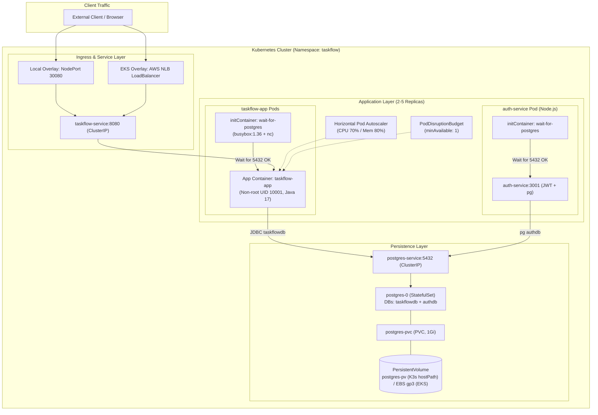

# ☸️ TaskFlow Kubernetes (K8s) Architecture & Deployment Guide

This directory contains the declarative Kubernetes infrastructure manifests for the **TaskFlow** application, structured using **Kustomize** with clean separation between reusable base configurations and environment-specific overlays (Local K3s/K3d and AWS EKS).

---

## 🏗️ Architecture Overview

The deployment follows cloud-native best practices with zero-downtime rolling updates, independent database persistence, automated horizontal scaling, and health monitoring:



### ASCII Architecture Reference

```text
[ External Client / Browser ]
         |
         +----------------------------------------------------+
         |                                                    |
         v (Local K3s / K3d)                                  v (AWS EKS)
  Traefik Ingress (:80 / :8081)                       AWS LoadBalancer (:80)
  or NodePorts: :30088 (UI) / :30080 (API)                    |
         |                                                    |
         +-------------------------+--------------------------+
                                   |
                                   v
                frontend-service:3000 (Next.js UI & BFF)
                                   |
    +--------------+---------------+---------------+--------------+--------------+
    |              |               |               |              |              |
    v              v               v               v              v              v
taskflow-     auth-service    analytics-     scheduler-     notification-  audit-service
service       :3001 (Node)    service        service        service        :8082 (Rust)
:8080 (Java)       |          :3002 (Node)   :3003 (Node)   :8081 (Go)           |
    |              |               |               |              |              v
    +------+-------+               +-------+-------+--------------+        audit-pvc /data
           |                               |                               (local-path / emptyDir)
           v                               v
postgres-service:5432            redis-service:6379
(PostgreSQL 16:                  (Redis 7 Pub/Sub,
 taskflowdb + authdb)             Cache & Alerts)
           |
           v
  postgres-pvc (1Gi PVC)
           |
           v
  PersistentVolume
  - Local K3s: postgres-pv (hostPath /var/lib/taskflow/postgres)
  - AWS EKS:   Dynamic EBS gp3 PV (ebs.csi.aws.com)
```

---

## 📁 Directory Structure

```text
k8s/
├── README.md                            # This comprehensive guide
├── aws.md                               # AWS Sydney (ap-southeast-2) EKS & ECS Deployment Guide
├── base/                                # Reusable, environment-agnostic base manifests
│   ├── namespace.yaml                   # Dedicated 'taskflow' namespace
│   ├── configmap.yaml                   # taskflow-config & taskflow-mesh-config (DNS URLs)
│   ├── secret.yaml                      # DB & JWT credentials
│   ├── postgres-service.yaml            # Internal ClusterIP service for PostgreSQL
│   ├── postgres-pvc.yaml                # PersistentVolumeClaim (1Gi RWO) for PostgreSQL
│   ├── postgres-statefulset.yaml        # PostgreSQL 16 StatefulSet (mounts postgres-pvc)
│   ├── redis.yaml                       # Redis 7 Deployment & ClusterIP Service (:6379)
│   ├── app-deployment.yaml              # TaskFlow Java API Deployment with initContainer & probes
│   ├── app-service.yaml                 # Internal ClusterIP service exposing port 8080
│   ├── microservices.yaml               # Auth (Node+PG), Analytics (Node), Scheduler (Node), Notif (Go), Audit (Rust)
│   ├── frontend.yaml                    # Next.js Standalone UI & BFF Deployment + Service (:3000)
│   ├── hpa.yaml                         # HorizontalPodAutoscaler (min 1, max 5)
│   ├── pdb.yaml                         # PodDisruptionBudget ensuring minAvailable: 1
│   └── kustomization.yaml               # Base Kustomize resource list
└── overlays/
    ├── local/                           # K3s / K3d / Minikube overlay
    │   ├── pv.yaml                      # Static PersistentVolume postgres-pv (1Gi hostPath, Retain)
    │   ├── pvc.yaml                     # K3s 'local-path' PVC for Rust Audit Service (audit-pvc, 256Mi)
    │   ├── postgres-pvc-patch.yaml      # Binds postgres-pvc -> postgres-pv (storageClassName: manual)
    │   ├── ingress.yaml                 # K3s Traefik Ingress (/ -> frontend, /swagger-ui -> taskflow-service)
    │   ├── service-patch.yaml           # Patches taskflow-service to NodePort 30080
    │   ├── frontend-service-patch.yaml  # Patches frontend-service to NodePort 30088
    │   └── kustomization.yaml           # Merges base + PV/PVCs + Ingress + volume patches
    └── eks/                             # Production AWS EKS overlay
        ├── gp3-storageclass.yaml        # AWS EBS CSI dynamic GP3 storage class
        ├── postgres-pvc-patch.yaml      # Patches postgres-pvc to storageClassName: gp3
        ├── frontend-service-patch.yaml  # Configures AWS internet-facing LoadBalancer (:80 -> :3000)
        ├── service-patch.yaml           # Legacy taskflow-service NLB patch
        └── kustomization.yaml           # Merges base with EKS patches & Docker Hub images
```

---

## 📦 Manifest Resource Breakdown

| Manifest | Kind | Description | Key Settings / Guarantees |
|---|---|---|---|
| [namespace.yaml](file:///c:/Users/Sidharth/Desktop/taskflow-devops/k8s/base/namespace.yaml) | `Namespace` | Isolates all TaskFlow components | Name: `taskflow` |
| [configmap.yaml](file:///c:/Users/Sidharth/Desktop/taskflow-devops/k8s/base/configmap.yaml) | `ConfigMap` | Runtime env vars | `taskflow-config` (Spring/DB) + `taskflow-mesh-config` (Redis & microservice URLs) |
| [secret.yaml](file:///c:/Users/Sidharth/Desktop/taskflow-devops/k8s/base/secret.yaml) | `Secret` | Sensitive credentials | `POSTGRES_USER`, `POSTGRES_PASSWORD`, `POSTGRES_DB`, `JWT_SECRET` |
| [postgres-pvc.yaml](file:///c:/Users/Sidharth/Desktop/taskflow-devops/k8s/base/postgres-pvc.yaml) | `PersistentVolumeClaim` | PostgreSQL storage claim | `postgres-pvc` (`1Gi`, `ReadWriteOnce`), bound to `postgres-pv` (K3s) or `gp3` (EKS) |
| [postgres-statefulset.yaml](file:///c:/Users/Sidharth/Desktop/taskflow-devops/k8s/base/postgres-statefulset.yaml) | `StatefulSet` | PostgreSQL 16 server | Mounts `postgres-pvc`; hosts `taskflowdb` + `authdb` |
| [redis.yaml](file:///c:/Users/Sidharth/Desktop/taskflow-devops/k8s/base/redis.yaml) | `Deployment` + `Service` | Redis 7 (`redis:7-alpine`) | Pub/Sub (`taskflow:events`), analytics cache & notifications (`:6379`) |
| [app-deployment.yaml](file:///c:/Users/Sidharth/Desktop/taskflow-devops/k8s/base/app-deployment.yaml) | `Deployment` | TaskFlow Java API (`:8080`) | `wait-for-postgres` initContainer, UID `10001`, health probes |
| [microservices.yaml](file:///c:/Users/Sidharth/Desktop/taskflow-devops/k8s/base/microservices.yaml) | `Deployment` + `Service` | 5 Polyglot Microservices | `auth` (`:3001`, Postgres `authdb`), `analytics` (`:3002`), `scheduler` (`:3003`), `notification` (`:8081`), `audit` (`:8082`) |
| [frontend.yaml](file:///c:/Users/Sidharth/Desktop/taskflow-devops/k8s/base/frontend.yaml) | `Deployment` + `Service` | Next.js Dashboard & BFF | Standalone image, UID `10001`, `/api/health` probes (`:3000`) |
| [hpa.yaml](file:///c:/Users/Sidharth/Desktop/taskflow-devops/k8s/base/hpa.yaml) | `HorizontalPodAutoscaler` | Dynamic autoscaling | Scales `taskflow-app` between 1 and 5 pods at 75% CPU |
| [pdb.yaml](file:///c:/Users/Sidharth/Desktop/taskflow-devops/k8s/base/pdb.yaml) | `PodDisruptionBudget` | High availability | Guarantees `minAvailable: 1` during node drains |

---

## 🧩 How Kustomize Works in TaskFlow

TaskFlow uses **Kubernetes-native Kustomize** (built directly into `kubectl`) so one clean set of `base/` manifests can be deployed anywhere without duplicating YAML files or maintaining complex Helm templates.

### Base vs. Environment Overlays

| Feature | `k8s/base/` | `k8s/overlays/local/` (K3s / K3d) | `k8s/overlays/eks/` (AWS EKS) |
|---|---|---|---|
| **Namespace** | `taskflow` | Inherits `taskflow` | Inherits `taskflow` |
| **External Exposure** | `ClusterIP` only (internal) | `NodePort` (`30088` UI, `30080` API) + Traefik `Ingress` | Single AWS `LoadBalancer` (`frontend-service :80 -> :3000`) |
| **Database Storage (PV + PVC)** | `postgres-pvc` (`1Gi` RWO) mounted in `StatefulSet/postgres` | Explicit `PersistentVolume/postgres-pv` (`hostPath`, `Retain`) + `postgres-pvc` (`manual`) + JSON 6902 patch for `audit-pvc` (`local-path`) | `postgres-pvc` patched to `storageClassName: gp3` + `gp3-storageclass.yaml` (dynamic EBS PV) |
| **Container Images** | Local tags (`taskflow-*:latest`) | Uses locally imported `k3d` / `k3s ctr` images | **`images:` transformer** → `sidharthhhh/taskflow-*` |

### Key Kustomize Techniques Used

1. **Strategic Merge Patches (`patches: - path: ...`)**:
   - Used in `postgres-pvc-patch.yaml`, `frontend-service-patch.yaml`, and `service-patch.yaml` to bind `postgres-pvc` (`manual` + `volumeName: postgres-pv` on K3s, `gp3` on EKS), override `spec.type` (`ClusterIP` → `NodePort` or `LoadBalancer`), and attach cloud annotations (`service.beta.kubernetes.io/aws-load-balancer-scheme: "internet-facing"`).
   - Uses `$patch: replace` where list fields like `spec.ports` should replace the base list instead of appending duplicate port names.
2. **JSON 6902 Patches (`op: replace`)**:
   - Used in [`k8s/overlays/local/kustomization.yaml`](file:///c:/Users/Sidharth/Desktop/taskflow-devops/k8s/overlays/local/kustomization.yaml) on `/spec/template/spec/volumes/0` for `Deployment/audit-service` (`emptyDir: {}` → `audit-pvc`).
   - Why? A Strategic Merge Patch cannot cleanly delete `emptyDir: {}` when switching to `persistentVolumeClaim:` (a Kubernetes volume cannot contain both keys). JSON 6902 `op: replace` swaps the exact array entry cleanly.
3. **Immutable Image Tag Injection (`images:` & `kustomize edit set image`)**:
   - In [`k8s/overlays/eks/kustomization.yaml`](file:///c:/Users/Sidharth/Desktop/taskflow-devops/k8s/overlays/eks/kustomization.yaml), the `images:` block rewrites all 7 container images at render time without editing `base/`:
     ```yaml
     images:
       - name: taskflow-app
         newName: sidharthhhh/taskflow-app
         newTag: latest
       - name: taskflow-frontend
         newName: sidharthhhh/taskflow-frontend
         newTag: latest
       # (+ auth, analytics, scheduler, notification, audit)
     ```
   - In CI/CD ([`cd-deploy.yml`](file:///c:/Users/Sidharth/Desktop/taskflow-devops/.github/workflows/cd-deploy.yml)), `kustomize edit set image` dynamically pins every image to `${{ github.sha }}` before `kubectl apply -k .`.

### Essential Kustomize Commands

```bash
# Preview the exact YAML Kustomize will generate (dry-run without applying)
kubectl kustomize k8s/overlays/local
kubectl kustomize k8s/overlays/eks

# Diff live cluster state against an overlay before deploying
kubectl diff -k k8s/overlays/local

# Apply or delete an entire environment stack in one command
kubectl apply -k k8s/overlays/local
kubectl delete -k k8s/overlays/local

# Override an image tag dynamically in the EKS overlay
cd k8s/overlays/eks && kustomize edit set image taskflow-frontend=sidharthhhh/taskflow-frontend:v1.0.1
```

---

## 🚀 Deployment Instructions

### 1A. Local Deployment on K3s (via `k3d`)

`k3d` runs lightweight K3s clusters inside local Docker containers, including K3s's built-in **Traefik Ingress** and **`local-path` storage provisioner**.

#### Step 1: Create the K3d Cluster
Expose NodePorts `30088` (Next.js UI), `30080` (Java API), and Traefik LoadBalancer `8081`:
```bash
k3d cluster create taskflow \
  --api-port 6550 \
  -p "30088:30088@server:0" \
  -p "30080:30080@server:0" \
  -p "8081:80@loadbalancer"
```

#### Step 2: Build & Import All 7 Container Images
```bash
docker build -t taskflow-app:latest ./services/task-service
docker build -t taskflow-auth-service:latest ./services/auth-service
docker build -t taskflow-analytics-service:latest ./services/analytics-service
docker build -t taskflow-scheduler-service:latest ./services/scheduler-service
docker build -t taskflow-notification-service:latest ./services/notification-service
docker build -t taskflow-audit-service:latest ./services/audit-service
docker build -t taskflow-frontend:latest ./frontend

k3d image import \
  taskflow-app:latest \
  taskflow-auth-service:latest \
  taskflow-analytics-service:latest \
  taskflow-scheduler-service:latest \
  taskflow-notification-service:latest \
  taskflow-audit-service:latest \
  taskflow-frontend:latest \
  -c taskflow
```

#### Step 3: Deploy via Kustomize Local Overlay
```bash
kubectl apply -k k8s/overlays/local
```

#### Step 4: Verify Rollout Status
```bash
# Watch all 9 pods until Running
kubectl get pods -n taskflow -w

# Verify services, Traefik Ingress, PV/PVCs, and HPA
kubectl get svc,ingress,pv,pvc,hpa -n taskflow
```

#### Step 5: Access the Stack
- **Next.js Control Plane UI (Traefik Ingress)**: [http://localhost:8081](http://localhost:8081)
- **Next.js Control Plane UI (NodePort)**: [http://localhost:30088](http://localhost:30088)
- **Swagger UI (Task Service)**: [http://localhost:30080/swagger-ui.html](http://localhost:30080/swagger-ui.html)
- **Actuator Health & Metrics**: [http://localhost:30080/actuator/health](http://localhost:30080/actuator/health) · [http://localhost:30080/actuator/prometheus](http://localhost:30080/actuator/prometheus)

#### Step 6: Cleanup
```bash
kubectl delete -k k8s/overlays/local
k3d cluster delete taskflow
```

---

### 1B. Native Single-Node / VM K3s Deployment (Linux / Ubuntu / WSL2)

If running **bare-metal / VM K3s directly** (without `k3d`), import locally built Docker images into K3s's `containerd` runtime and apply the same `k8s/overlays/local` overlay:

```bash
# 1. Build all 7 images with Docker
docker build -t taskflow-app:latest ./services/task-service
docker build -t taskflow-auth-service:latest ./services/auth-service
docker build -t taskflow-analytics-service:latest ./services/analytics-service
docker build -t taskflow-scheduler-service:latest ./services/scheduler-service
docker build -t taskflow-notification-service:latest ./services/notification-service
docker build -t taskflow-audit-service:latest ./services/audit-service
docker build -t taskflow-frontend:latest ./frontend

# 2. Import images directly into K3s containerd
for img in taskflow-app taskflow-auth-service taskflow-analytics-service taskflow-scheduler-service taskflow-notification-service taskflow-audit-service taskflow-frontend; do
  docker save "${img}:latest" | sudo k3s ctr images import -
done

# 3. Deploy K3s overlay (uses K3s Traefik Ingress + local-path PVCs + NodePorts)
sudo k3s kubectl apply -k k8s/overlays/local

# 4. Verify pods, PV/PVCs, and Ingress
sudo k3s kubectl get pods,svc,ingress,pv,pvc -n taskflow
```

Access via Traefik on port `80` (`http://<K3S_NODE_IP>/`) or NodePort `http://<K3S_NODE_IP>:30088`!

---

### 2. Production Deployment on AWS EKS (`ap-southeast-2` Sydney)

The EKS overlay (`k8s/overlays/eks`) exposes **`frontend-service`** via EKS's built-in in-tree AWS LoadBalancer (`port 80 -> 3000`) and maps all 7 container images to Docker Hub (`sidharthhhh/*`) or Amazon ECR. *(See [**`k8s/aws.md`**](file:///c:/Users/Sidharth/Desktop/taskflow-devops/k8s/aws.md) for the complete AWS setup guide.)*

#### Step 1: Build & Push Images (Docker Hub or Amazon ECR)
```bash
export DOCKER_USER="sidharthhhh"
docker build --platform linux/amd64 -t ${DOCKER_USER}/taskflow-app:latest ./services/task-service
docker build --platform linux/amd64 -t ${DOCKER_USER}/taskflow-auth-service:latest ./services/auth-service
docker build --platform linux/amd64 -t ${DOCKER_USER}/taskflow-analytics-service:latest ./services/analytics-service
docker build --platform linux/amd64 -t ${DOCKER_USER}/taskflow-scheduler-service:latest ./services/scheduler-service
docker build --platform linux/amd64 -t ${DOCKER_USER}/taskflow-notification-service:latest ./services/notification-service
docker build --platform linux/amd64 -t ${DOCKER_USER}/taskflow-audit-service:latest ./services/audit-service
docker build --platform linux/amd64 -t ${DOCKER_USER}/taskflow-frontend:latest ./frontend
```

#### Step 2: Override Image Tags via Kustomize *(Optional if using `:latest`)*
```bash
cd k8s/overlays/eks
kustomize edit set image taskflow-frontend=${DOCKER_USER}/taskflow-frontend:v1.0.0
cd ../../..
```

#### Step 3: Apply Manifests
```bash
kubectl apply -k k8s/overlays/eks
```

#### Step 4: Monitor LoadBalancer Provisioning
```bash
kubectl get svc frontend-service -n taskflow -w
```
Wait until `EXTERNAL-IP` resolves to an AWS ELB DNS name (e.g., `xxx.ap-southeast-2.elb.amazonaws.com`).

#### Step 5: Verify Live Stack
```bash
# Open Next.js UI in browser: http://<EXTERNAL-IP>/
curl http://<EXTERNAL-IP>/api/health
curl http://<EXTERNAL-IP>/api/tasks
```

#### Step 6: Cleanup (Always delete K8s LoadBalancer before `terraform destroy`)
```bash
kubectl delete -k k8s/overlays/eks
```

---

## 🛠️ Kubernetes Operational Cheatsheet

### Rolling Restarts & Updates
```bash
# Restart any microservice deployment gracefully without downtime
kubectl rollout restart deployment/taskflow-frontend -n taskflow
kubectl rollout restart deployment/taskflow-app -n taskflow

# View rollout status & revision history
kubectl rollout status deployment/taskflow-app -n taskflow
kubectl rollout history deployment/taskflow-app -n taskflow

# Rollback to previous deployment revision
kubectl rollout undo deployment/taskflow-app -n taskflow
```

### Manual Scaling
```bash
# Scale application pods (HPA will adjust if minReplicas isn't updated)
kubectl scale deployment/taskflow-app -n taskflow --replicas=2
```

### Port Forwarding (Debugging without NodePort/LB)
```bash
# Forward Next.js UI & BFF port 3000 to local port 3000
kubectl port-forward svc/frontend-service -n taskflow 3000:3000

# Forward Task Service API port 8080
kubectl port-forward svc/taskflow-service -n taskflow 8080:8080

# Forward Redis (6379) & PostgreSQL (5432)
kubectl port-forward svc/redis-service -n taskflow 6379:6379
kubectl port-forward svc/postgres-service -n taskflow 5432:5432
```

---

## 🔍 Comprehensive Troubleshooting Guide

Real-world operational issues, underlying root causes, and step-by-step remedies:

---

### Scenario 1: Windows K3d API Server Timeout (`host.docker.internal`)
- **Symptoms**:
  - `kubectl` commands hang and fail with:
    ```text
    Unable to connect to the server: dial tcp: lookup host.docker.internal: no such host
    ```
  - Or connection timed out connecting to `https://host.docker.internal:<port>`.
- **Root Cause**:
  Docker Desktop on Windows often resolves `host.docker.internal` in kubeconfig to the physical LAN adapter (e.g. Wi-Fi IP `192.168.x.x`) instead of the local loopback `127.0.0.1`, dropping packets on external network interfaces.
- **Solution**:
  Point the cluster server endpoint directly to loopback `127.0.0.1`:
  ```powershell
  # 1. Identify the port mapped to k3d API server
  docker ps --filter "name=k3d-taskflow-server-0" --format "{{.Ports}}"

  # 2. Update kubeconfig cluster endpoint (e.g., port 6550)
  kubectl config set-cluster k3d-taskflow --server=https://127.0.0.1:6550 --insecure-skip-tls-verify=true

  # 3. Test connectivity
  kubectl get nodes
  ```

---

### Scenario 2: PostgreSQL CrashLoopBackOff on Volume Mount (`lost+found`)
- **Symptoms**:
  - `postgres-0` crashes on startup.
  - `kubectl logs -n taskflow postgres-0` displays:
    ```text
    initdb: directory "/var/lib/postgresql/data" exists but is not empty
    It contains a lost+found directory, perhaps due to it being a mount point.
    ```
- **Root Cause**:
  When a PersistentVolume formatted with `ext4` (EBS, local-path, or hostpath) is mounted at `/var/lib/postgresql/data`, the operating system automatically places a `lost+found` directory at the mount root. PostgreSQL's `initdb` command expects an empty directory.
- **Solution**:
  Direct PostgreSQL to initialize and store files in a subfolder using `PGDATA`:
  ```yaml
  env:
    - name: PGDATA
      value: /var/lib/postgresql/data/pgdata
  ```
  *(Already configured in `k8s/base/postgres-statefulset.yaml`)*.

---

### Scenario 3: Cold Boot CrashLoopBackOff on Application Pods
- **Symptoms**:
  - Application pods restart 2–5 times upon initial deployment:
    ```text
    org.postgresql.util.PSQLException: Connection to postgres-service:5432 refused
    ```
- **Root Cause**:
  Kubernetes schedules the application deployment and PostgreSQL StatefulSet concurrently. The Spring Boot application starts fast (3-5s) and fails immediately before PostgreSQL has completed creating schemas and opening socket `5432`.
- **Solution**:
  Use the `wait-for-postgres` initContainer in `app-deployment.yaml`. It polls PostgreSQL port 5432 with `nc` (netcat) before launching Spring Boot:
  ```yaml
  initContainers:
    - name: wait-for-postgres
      image: busybox:1.36
      command: ['sh', '-c', 'until nc -z -w 2 postgres-service 5432; do echo "Waiting for PostgreSQL..."; sleep 2; done;']
  ```
  Check initContainer logs if pods remain in `Init:0/1`:
  ```bash
  kubectl logs -n taskflow <pod-name> -c wait-for-postgres
  ```

---

### Scenario 4: Hibernate 6 Enum DDL Error (`ERROR: type "enum" does not exist`)
- **Symptoms**:
  - Spring Boot fails to start on PostgreSQL with:
    ```text
    org.hibernate.tool.schema.spi.CommandAcceptanceException: Error executing DDL:
    create table tasks (..., status enum ('TODO','IN_PROGRESS','DONE'))
    Caused by: org.postgresql.util.PSQLException: ERROR: type "enum" does not exist
    ```
- **Root Cause**:
  Hibernate 6 generates `enum (...)` DDL when explicit dialect is forced or misconfigured as `H2Dialect`. PostgreSQL requires either a custom `CREATE TYPE` or mapping enums to `VARCHAR`.
- **Solution**:
  1. Add `@JdbcTypeCode(SqlTypes.VARCHAR)` in the entity (`Task.java`):
     ```java
     @Enumerated(EnumType.STRING)
     @JdbcTypeCode(SqlTypes.VARCHAR)
     @Column(nullable = false, length = 50)
     private TaskStatus status;
     ```
  2. Omit `spring.jpa.database-platform` in `application.yml` so Hibernate 6 auto-detects `org.hibernate.dialect.PostgreSQLDialect` from the JDBC connection.

---

### Scenario 5: ImagePullBackOff / ErrImagePull in Local K3s/K3d
- **Symptoms**:
  - Pod status shows `ImagePullBackOff` or `ErrImagePull`:
    ```text
    Failed to pull image "taskflow-app:latest": rpc error: code = NotFound
    ```
- **Root Cause**:
  `k3d` runs inside Docker containers with its own container runtime. It does not automatically have access to images built on your host machine's Docker daemon unless imported.
- **Solution**:
  1. Import the local Docker image into the k3d cluster:
     ```bash
     k3d image import taskflow-app:latest -c taskflow
     ```
  2. Confirm `imagePullPolicy: IfNotPresent` is set in `app-deployment.yaml` so Kubernetes uses the imported image without trying to pull from Docker Hub.

---

### Scenario 6: Pod Stuck in `Pending` due to Unbound PersistentVolumeClaim
- **Symptoms**:
  - `postgres-0` remains in `Pending` state indefinitely.
  - `kubectl describe pod -n taskflow postgres-0` displays:
    ```text
    0/1 nodes available: pod has unbound immediate PersistentVolumeClaims
    ```
- **Root Cause**:
  The cluster has no default `StorageClass` configured, or the dynamic volume provisioner (e.g. AWS EBS CSI Driver on EKS or `local-path` on K3s) is not running.
- **Solution**:
  Check StorageClasses:
  ```bash
  kubectl get sc
  kubectl get pv,pvc -n taskflow
  kubectl describe pvc postgres-pvc -n taskflow
  ```
  On AWS EKS, verify the Amazon EBS CSI driver add-on is installed:
  ```bash
  aws eks describe-addon --cluster-name <cluster-name> --addon-name aws-ebs-csi-driver
  # Or enable it if not yet installed:
  aws eks create-addon --cluster-name <cluster-name> --addon-name aws-ebs-csi-driver
  ```

---

### Scenario 7: Pod Terminated with `OOMKilled` (Exit Code 137)
- **Symptoms**:
  - Pod suddenly restarts and `kubectl describe pod` shows:
    ```text
    Last State: Terminated
    Reason: OOMKilled
    Exit Code: 137
    ```
- **Root Cause**:
  JVM heap allocation exceeded the container cgroup memory limit (`512Mi`).
- **Solution**:
  1. Ensure container cgroup memory awareness is enabled in the Dockerfile:
     ```bash
     ENV JAVA_OPTS="-XX:+UseContainerSupport -XX:MaxRAMPercentage=75.0"
     ```
  2. If traffic load is high, adjust memory limits in `app-deployment.yaml`:
     ```yaml
     resources:
       requests:
         memory: "384Mi"
       limits:
         memory: "768Mi"
     ```

---

### Scenario 8: Readiness Probe Failing (503 Service Unavailable)
- **Symptoms**:
  - Pod shows `0/1 Running` and endpoints return `503 Service Unavailable`.
  - `kubectl describe pod` shows:
    ```text
    Warning Unhealthy 5s kubelet Readiness probe failed: HTTP probe failed with statuscode: 503
    ```
- **Root Cause**:
  Spring Boot's `/actuator/health/readiness` returned DOWN. This happens if the database connection drops or disk space falls below the threshold.
- **Solution**:
  Examine the detailed health status inside the pod:
  ```bash
  kubectl exec -it -n taskflow <pod-name> -- wget -qO- http://localhost:8080/actuator/health
  ```
  Check PostgreSQL container health and ensure the credentials in `secret.yaml` match the database.

---

### Scenario 9: AWS NLB LoadBalancer Stuck in `<pending>` on EKS
- **Symptoms**:
  - `kubectl get svc -n taskflow` shows `EXTERNAL-IP: <pending>` indefinitely.
- **Root Cause**:
  The AWS Load Balancer Controller is either not installed, lacks IAM permissions, or VPC subnets are missing the required discovery tags.
- **Solution**:
  1. Verify the AWS Load Balancer Controller is running:
     ```bash
     kubectl get pods -n kube-system -l app.kubernetes.io/name=aws-load-balancer-controller
     ```
  2. Check controller logs:
     ```bash
     kubectl logs -n kube-system -l app.kubernetes.io/name=aws-load-balancer-controller -f
     ```
  3. Ensure public subnets are tagged for public ELBs:
     `kubernetes.io/role/elb = 1`
  4. Ensure private subnets are tagged for internal ELBs:
     `kubernetes.io/role/internal-elb = 1`

---

### Scenario 10: Direct Database Inspection via `psql`
To directly inspect both databases (`taskflowdb` and `authdb`), schemas, and live rows in Kubernetes:
```bash
# Exec into postgres-0 pod with psql
kubectl exec -it -n taskflow postgres-0 -- psql -U taskflow -d taskflowdb

# Useful inspection queries:
\l                    # List databases (taskflowdb and authdb should be present)
\dt                   # List tables in taskflowdb (tasks)
SELECT id, title, status, created_at FROM tasks;

\c authdb             # Switch to auth-service database
\dt                   # List tables in authdb (auth_users)
SELECT email, name, role, created_at FROM auth_users;
\q                    # Exit psql
```
