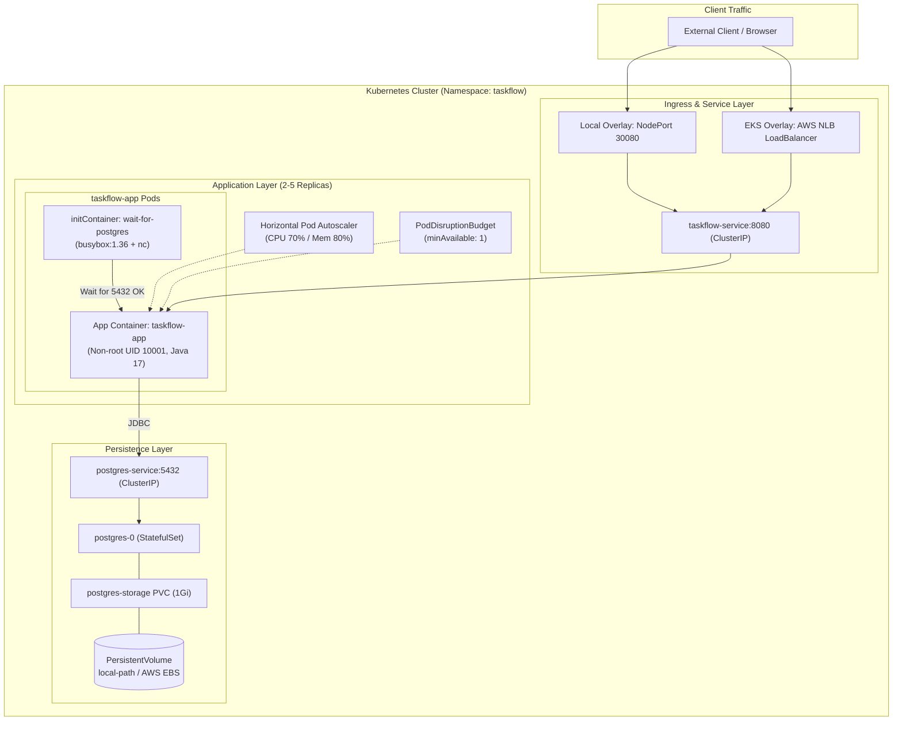

# ☸️ TaskFlow Kubernetes (K8s) Architecture & Deployment Guide

This directory contains the declarative Kubernetes infrastructure manifests for the **TaskFlow** application, structured using **Kustomize** with clean separation between reusable base configurations and environment-specific overlays (Local K3s/K3d and AWS EKS).

---

## 🏗️ Architecture Overview

The deployment follows cloud-native best practices with zero-downtime rolling updates, independent database persistence, automated horizontal scaling, and health monitoring:



### ASCII Architecture Reference

```text
[ External Client / Browser ]
         |
         +-------------------------------------+
         |                                     |
         v (Local K3s)                         v (AWS EKS)
  NodePort 30080                   AWS Network Load Balancer (NLB)
         |                                     |
         +------------------+------------------+
                            |
                            v
             taskflow-service:8080 (ClusterIP)
                            |
   +------------------------v------------------------+
   | Application Layer: taskflow-app (2..5 Pods)     |
   |   - HPA: Scales 2..5 at 70% CPU / 80% RAM       |
   |   - PDB: minAvailable: 1                        |
   |                                                 |
   |   Pod Lifecycle:                                |
   |     1. [initContainer: wait-for-postgres]       |
   |           | (polls port 5432 until ready)       |
   |           v                                     |
   |     2. [App Container: taskflow-app (Java 17)]  |
   +------------------------+------------------------+
                            | JDBC Connection (Port 5432)
                            v
             postgres-service:5432 (ClusterIP)
                            |
             postgres-0 (PostgreSQL 16 StatefulSet)
                            |
             postgres-storage PVC (1Gi)
                            |
             PersistentVolume (local-path / AWS EBS gp3)
```

---

## 📁 Directory Structure

```text
k8s/
├── README.md                            # This comprehensive guide
├── base/                                # Reusable, environment-agnostic base manifests
│   ├── namespace.yaml                   # Dedicated 'taskflow' namespace
│   ├── configmap.yaml                   # Environment variables (port, DB URL, actuator)
│   ├── secret.yaml                      # DB credentials (base64 encoded)
│   ├── postgres-service.yaml            # Internal ClusterIP service for PostgreSQL
│   ├── postgres-statefulset.yaml        # PostgreSQL 16 StatefulSet with 1Gi volumeClaimTemplate
│   ├── app-deployment.yaml              # 2-replica Deployment with initContainer & probes
│   ├── app-service.yaml                 # Internal ClusterIP service exposing port 8080
│   ├── hpa.yaml                         # HorizontalPodAutoscaler (min 2, max 5)
│   ├── pdb.yaml                         # PodDisruptionBudget ensuring minAvailable: 1
│   └── kustomization.yaml               # Base Kustomize resource list
└── overlays/
    ├── local/                           # Local development overlay (K3s, K3d, Minikube)
    │   ├── service-patch.yaml           # Patches app-service to NodePort 30080
    │   └── kustomization.yaml           # Merges base with local patches
    └── eks/                             # Production AWS EKS overlay
        ├── service-patch.yaml           # Configures AWS Network Load Balancer (NLB) annotations
        └── kustomization.yaml           # Merges base with EKS patches
```

---

## 📦 Manifest Resource Breakdown

| Manifest | Kind | Description | Key Settings / Guarantees |
|---|---|---|---|
| [namespace.yaml](file:///c:/Users/Sidharth/Desktop/taskflow-devops/k8s/base/namespace.yaml) | `Namespace` | Isolates all TaskFlow components | Name: `taskflow` |
| [configmap.yaml](file:///c:/Users/Sidharth/Desktop/taskflow-devops/k8s/base/configmap.yaml) | `ConfigMap` | Non-sensitive runtime variables | Points JDBC URL to `postgres-service:5432` |
| [secret.yaml](file:///c:/Users/Sidharth/Desktop/taskflow-devops/k8s/base/secret.yaml) | `Secret` | Database credentials | Base64 encoded `POSTGRES_USER` & `POSTGRES_PASSWORD` |
| [postgres-service.yaml](file:///c:/Users/Sidharth/Desktop/taskflow-devops/k8s/base/postgres-service.yaml) | `Service` | Stable DNS for PostgreSQL | ClusterIP on port `5432` |
| [postgres-statefulset.yaml](file:///c:/Users/Sidharth/Desktop/taskflow-devops/k8s/base/postgres-statefulset.yaml) | `StatefulSet` | PostgreSQL 16 server | Mounts `1Gi` PVC with `PGDATA` pointing to subfolder |
| [app-deployment.yaml](file:///c:/Users/Sidharth/Desktop/taskflow-devops/k8s/base/app-deployment.yaml) | `Deployment` | TaskFlow Spring Boot API | 2 Replicas, non-root user `10001`, liveness/readiness probes |
| [app-service.yaml](file:///c:/Users/Sidharth/Desktop/taskflow-devops/k8s/base/app-service.yaml) | `Service` | Exposes TaskFlow internally | ClusterIP on port `8080` (patched in overlays) |
| [hpa.yaml](file:///c:/Users/Sidharth/Desktop/taskflow-devops/k8s/base/hpa.yaml) | `HorizontalPodAutoscaler` | Dynamic autoscaling | Scale between 2 and 5 pods at 70% CPU / 80% RAM |
| [pdb.yaml](file:///c:/Users/Sidharth/Desktop/taskflow-devops/k8s/base/pdb.yaml) | `PodDisruptionBudget` | High availability during maintenance | Ensures `minAvailable: 1` during node drains or upgrades |

---

## 🚀 Deployment Instructions

### 1. Local Deployment with K3s (via `k3d`)

`k3d` runs lightweight K3s clusters inside local Docker containers, providing a near-instant Kubernetes environment.

#### Step 1: Create the K3d Cluster
Expose NodePort `30080` and LoadBalancer `8081` on your local machine:
```bash
k3d cluster create taskflow \
  --api-port 6550 \
  -p "30080:30080@server:0" \
  -p "8081:80@loadbalancer"
```

#### Step 2: Build & Import Application Container
```bash
# Build image from the app directory
docker build -t taskflow-app:latest ./app

# Import the image directly into k3d
k3d image import taskflow-app:latest -c taskflow
```

#### Step 3: Deploy via Kustomize Local Overlay
```bash
kubectl apply -k k8s/overlays/local
```

#### Step 4: Verify Rollout Status
```bash
# Watch pods until all are 1/1 Running
kubectl get pods -n taskflow -w

# Wait for deployment rollout to finish
kubectl rollout status deployment/taskflow-app -n taskflow --timeout=90s

# Verify services, PVCs, and HPA
kubectl get svc,pvc,hpa,pdb -n taskflow
```

#### Step 5: Test the Application
- **Swagger UI**: [http://localhost:30080/swagger-ui.html](http://localhost:30080/swagger-ui.html)
- **Actuator Health**: [http://localhost:30080/actuator/health](http://localhost:30080/actuator/health)
- **Prometheus Metrics**: [http://localhost:30080/actuator/prometheus](http://localhost:30080/actuator/prometheus)
- **App Metadata**: [http://localhost:30080/api/info](http://localhost:30080/api/info)

#### Step 6: Cleanup
```bash
kubectl delete -k k8s/overlays/local
k3d cluster delete taskflow
```

---

### 2. Production Deployment on AWS EKS

The EKS overlay provisions an **AWS Network Load Balancer (NLB)** utilizing the official AWS Load Balancer Controller.

#### Step 1: Build & Push Image to Amazon ECR
```bash
export AWS_REGION="us-east-1"
export AWS_ACCOUNT_ID="123456789012"
export ECR_REPO="${AWS_ACCOUNT_ID}.dkr.ecr.${AWS_REGION}.amazonaws.com/taskflow-app"

# Authenticate Docker client to ECR
aws ecr get-login-password --region ${AWS_REGION} | docker login --username AWS --password-stdin ${ECR_REPO}

# Build and push tagged container
docker build -t ${ECR_REPO}:v1.0.0 ./app
docker push ${ECR_REPO}:v1.0.0
```

#### Step 2: Configure Image in EKS Overlay
Update `k8s/overlays/eks/kustomization.yaml` or use `kustomize edit`:
```bash
cd k8s/overlays/eks
kustomize edit set image taskflow-app=${ECR_REPO}:v1.0.0
cd ../../
```

#### Step 3: Apply Manifests
```bash
kubectl apply -k k8s/overlays/eks
```

#### Step 4: Monitor LoadBalancer Provisioning
```bash
kubectl get svc taskflow-service -n taskflow -w
```
Wait until the `EXTERNAL-IP` resolves to an AWS DNS name (e.g., `k8s-taskflow-xxx.elb.us-east-1.amazonaws.com`).

#### Step 5: Verify Production Endpoints
```bash
curl http://<EXTERNAL-IP>/actuator/health
curl http://<EXTERNAL-IP>/api/info
```

#### Step 6: Cleanup
```bash
kubectl delete -k k8s/overlays/eks
```

---

## 🛠️ Kubernetes Operational Cheatsheet

### Rolling Restarts & Updates
```bash
# Restart deployment pods gracefully without downtime
kubectl rollout restart deployment/taskflow-app -n taskflow

# View rollout status
kubectl rollout status deployment/taskflow-app -n taskflow

# View rollout revision history
kubectl rollout history deployment/taskflow-app -n taskflow

# Rollback to previous deployment revision
kubectl rollout undo deployment/taskflow-app -n taskflow
```

### Manual Scaling
```bash
# Scale application pods to 4 replicas (HPA will adjust if enabled)
kubectl scale deployment/taskflow-app -n taskflow --replicas=4
```

### Port Forwarding (Debugging without NodePort/LB)
```bash
# Forward application port 8080 to local port 8080
kubectl port-forward svc/taskflow-service -n taskflow 8080:8080

# Forward PostgreSQL port 5432 to local port 5432
kubectl port-forward svc/postgres-service -n taskflow 5432:5432
```

---

## 🔍 Comprehensive Troubleshooting Guide

Real-world operational issues, underlying root causes, and step-by-step remedies:

---

### Scenario 1: Windows K3d API Server Timeout (`host.docker.internal`)
- **Symptoms**:
  - `kubectl` commands hang and fail with:
    ```text
    Unable to connect to the server: dial tcp: lookup host.docker.internal: no such host
    ```
  - Or connection timed out connecting to `https://host.docker.internal:<port>`.
- **Root Cause**:
  Docker Desktop on Windows often resolves `host.docker.internal` in kubeconfig to the physical LAN adapter (e.g. Wi-Fi IP `192.168.x.x`) instead of the local loopback `127.0.0.1`, dropping packets on external network interfaces.
- **Solution**:
  Point the cluster server endpoint directly to loopback `127.0.0.1`:
  ```powershell
  # 1. Identify the port mapped to k3d API server
  docker ps --filter "name=k3d-taskflow-server-0" --format "{{.Ports}}"

  # 2. Update kubeconfig cluster endpoint (e.g., port 6550)
  kubectl config set-cluster k3d-taskflow --server=https://127.0.0.1:6550 --insecure-skip-tls-verify=true

  # 3. Test connectivity
  kubectl get nodes
  ```

---

### Scenario 2: PostgreSQL CrashLoopBackOff on Volume Mount (`lost+found`)
- **Symptoms**:
  - `postgres-0` crashes on startup.
  - `kubectl logs -n taskflow postgres-0` displays:
    ```text
    initdb: directory "/var/lib/postgresql/data" exists but is not empty
    It contains a lost+found directory, perhaps due to it being a mount point.
    ```
- **Root Cause**:
  When a PersistentVolume formatted with `ext4` (EBS, local-path, or hostpath) is mounted at `/var/lib/postgresql/data`, the operating system automatically places a `lost+found` directory at the mount root. PostgreSQL's `initdb` command expects an empty directory.
- **Solution**:
  Direct PostgreSQL to initialize and store files in a subfolder using `PGDATA`:
  ```yaml
  env:
    - name: PGDATA
      value: /var/lib/postgresql/data/pgdata
  ```
  *(Already configured in `k8s/base/postgres-statefulset.yaml`)*.

---

### Scenario 3: Cold Boot CrashLoopBackOff on Application Pods
- **Symptoms**:
  - Application pods restart 2–5 times upon initial deployment:
    ```text
    org.postgresql.util.PSQLException: Connection to postgres-service:5432 refused
    ```
- **Root Cause**:
  Kubernetes schedules the application deployment and PostgreSQL StatefulSet concurrently. The Spring Boot application starts fast (3-5s) and fails immediately before PostgreSQL has completed creating schemas and opening socket `5432`.
- **Solution**:
  Use the `wait-for-postgres` initContainer in `app-deployment.yaml`. It polls PostgreSQL port 5432 with `nc` (netcat) before launching Spring Boot:
  ```yaml
  initContainers:
    - name: wait-for-postgres
      image: busybox:1.36
      command: ['sh', '-c', 'until nc -z -w 2 postgres-service 5432; do echo "Waiting for PostgreSQL..."; sleep 2; done;']
  ```
  Check initContainer logs if pods remain in `Init:0/1`:
  ```bash
  kubectl logs -n taskflow <pod-name> -c wait-for-postgres
  ```

---

### Scenario 4: Hibernate 6 Enum DDL Error (`ERROR: type "enum" does not exist`)
- **Symptoms**:
  - Spring Boot fails to start on PostgreSQL with:
    ```text
    org.hibernate.tool.schema.spi.CommandAcceptanceException: Error executing DDL:
    create table tasks (..., status enum ('TODO','IN_PROGRESS','DONE'))
    Caused by: org.postgresql.util.PSQLException: ERROR: type "enum" does not exist
    ```
- **Root Cause**:
  Hibernate 6 generates `enum (...)` DDL when explicit dialect is forced or misconfigured as `H2Dialect`. PostgreSQL requires either a custom `CREATE TYPE` or mapping enums to `VARCHAR`.
- **Solution**:
  1. Add `@JdbcTypeCode(SqlTypes.VARCHAR)` in the entity (`Task.java`):
     ```java
     @Enumerated(EnumType.STRING)
     @JdbcTypeCode(SqlTypes.VARCHAR)
     @Column(nullable = false, length = 50)
     private TaskStatus status;
     ```
  2. Omit `spring.jpa.database-platform` in `application.yml` so Hibernate 6 auto-detects `org.hibernate.dialect.PostgreSQLDialect` from the JDBC connection.

---

### Scenario 5: ImagePullBackOff / ErrImagePull in Local K3s/K3d
- **Symptoms**:
  - Pod status shows `ImagePullBackOff` or `ErrImagePull`:
    ```text
    Failed to pull image "taskflow-app:latest": rpc error: code = NotFound
    ```
- **Root Cause**:
  `k3d` runs inside Docker containers with its own container runtime. It does not automatically have access to images built on your host machine's Docker daemon unless imported.
- **Solution**:
  1. Import the local Docker image into the k3d cluster:
     ```bash
     k3d image import taskflow-app:latest -c taskflow
     ```
  2. Confirm `imagePullPolicy: IfNotPresent` is set in `app-deployment.yaml` so Kubernetes uses the imported image without trying to pull from Docker Hub.

---

### Scenario 6: Pod Stuck in `Pending` due to Unbound PersistentVolumeClaim
- **Symptoms**:
  - `postgres-0` remains in `Pending` state indefinitely.
  - `kubectl describe pod -n taskflow postgres-0` displays:
    ```text
    0/1 nodes available: pod has unbound immediate PersistentVolumeClaims
    ```
- **Root Cause**:
  The cluster has no default `StorageClass` configured, or the dynamic volume provisioner (e.g. AWS EBS CSI Driver on EKS or `local-path` on K3s) is not running.
- **Solution**:
  Check StorageClasses:
  ```bash
  kubectl get sc
  kubectl describe pvc postgres-storage-postgres-0 -n taskflow
  ```
  On AWS EKS, verify the Amazon EBS CSI driver add-on is installed:
  ```bash
  aws eks describe-addon --cluster-name <cluster-name> --addon-name aws-ebs-csi-driver
  ```

---

### Scenario 7: Pod Terminated with `OOMKilled` (Exit Code 137)
- **Symptoms**:
  - Pod suddenly restarts and `kubectl describe pod` shows:
    ```text
    Last State: Terminated
    Reason: OOMKilled
    Exit Code: 137
    ```
- **Root Cause**:
  JVM heap allocation exceeded the container cgroup memory limit (`512Mi`).
- **Solution**:
  1. Ensure container cgroup memory awareness is enabled in the Dockerfile:
     ```bash
     ENV JAVA_OPTS="-XX:+UseContainerSupport -XX:MaxRAMPercentage=75.0"
     ```
  2. If traffic load is high, adjust memory limits in `app-deployment.yaml`:
     ```yaml
     resources:
       requests:
         memory: "384Mi"
       limits:
         memory: "768Mi"
     ```

---

### Scenario 8: Readiness Probe Failing (503 Service Unavailable)
- **Symptoms**:
  - Pod shows `0/1 Running` and endpoints return `503 Service Unavailable`.
  - `kubectl describe pod` shows:
    ```text
    Warning Unhealthy 5s kubelet Readiness probe failed: HTTP probe failed with statuscode: 503
    ```
- **Root Cause**:
  Spring Boot's `/actuator/health/readiness` returned DOWN. This happens if the database connection drops or disk space falls below the threshold.
- **Solution**:
  Examine the detailed health status inside the pod:
  ```bash
  kubectl exec -it -n taskflow <pod-name> -- wget -qO- http://localhost:8080/actuator/health
  ```
  Check PostgreSQL container health and ensure the credentials in `secret.yaml` match the database.

---

### Scenario 9: AWS NLB LoadBalancer Stuck in `<pending>` on EKS
- **Symptoms**:
  - `kubectl get svc -n taskflow` shows `EXTERNAL-IP: <pending>` indefinitely.
- **Root Cause**:
  The AWS Load Balancer Controller is either not installed, lacks IAM permissions, or VPC subnets are missing the required discovery tags.
- **Solution**:
  1. Verify the AWS Load Balancer Controller is running:
     ```bash
     kubectl get pods -n kube-system -l app.kubernetes.io/name=aws-load-balancer-controller
     ```
  2. Check controller logs:
     ```bash
     kubectl logs -n kube-system -l app.kubernetes.io/name=aws-load-balancer-controller -f
     ```
  3. Ensure public subnets are tagged for public ELBs:
     `kubernetes.io/role/elb = 1`
  4. Ensure private subnets are tagged for internal ELBs:
     `kubernetes.io/role/internal-elb = 1`

---

### Scenario 10: Direct Database Inspection via `psql`
To directly inspect database tables, schemas, and live rows in Kubernetes:
```bash
# Exec into postgres-0 pod with psql
kubectl exec -it -n taskflow postgres-0 -- psql -U taskflow -d taskflowdb

# Useful inspection queries:
\dt                   # List tables (tasks should be present)
\d tasks              # Describe tasks table schema
SELECT id, title, status, created_at FROM tasks;
\q                    # Exit psql
```
