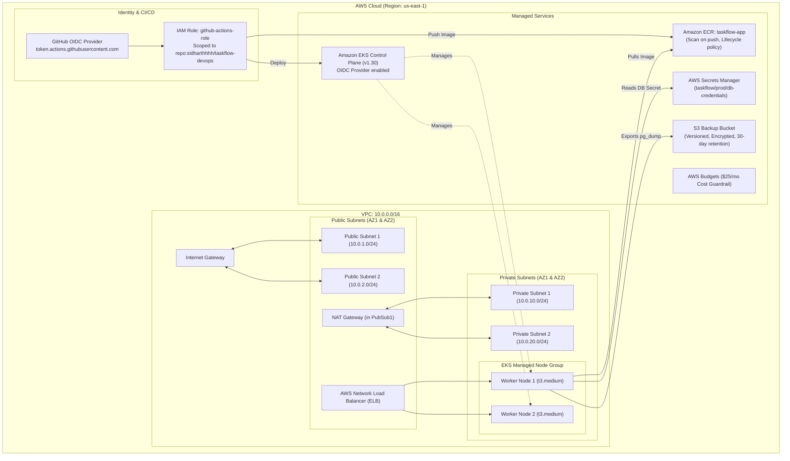

# 🌍 TaskFlow AWS Cloud Infrastructure (Terraform) - Complete Reference Guide

This documentation provides an end-to-end guide to the **Terraform Infrastructure as Code (IaC)** for the **TaskFlow** platform on Amazon Web Services (AWS). It covers architectural design, module internals, execution workflows, security guardrails, and practical troubleshooting.

---

## 🏗️ Cloud Infrastructure Architecture



---

## 📁 Repository Directory Structure

```text
terraform/
├── readme/
│   └── README.md                        # This detailed reference and troubleshooting guide
├── bootstrap/                           # State storage bootstrap (run first)
│   ├── main.tf                          # S3 state bucket & DynamoDB lock table
│   ├── variables.tf                     # Bootstrap configuration inputs
│   └── outputs.tf                       # State bucket name & backend code snippet
├── modules/
│   ├── vpc/                             # Modular VPC and networking
│   │   ├── main.tf                      # Multi-AZ VPC, subnets, NAT Gateway, IGW, ELB tags
│   │   ├── variables.tf
│   │   └── outputs.tf
│   ├── ecr/                             # Amazon ECR container registry
│   │   ├── main.tf                      # Image scanning on push & 14-day/30-image lifecycle policy
│   │   ├── variables.tf
│   │   └── outputs.tf
│   └── eks/                             # Amazon EKS cluster & managed node group
│       ├── main.tf                      # EKS 1.30, private worker nodes, OIDC IRSA, EBS CSI driver
│       ├── variables.tf
│       └── outputs.tf
├── versions.tf                          # Provider requirements & remote backend block
├── providers.tf                         # AWS provider with default tags
├── variables.tf                         # Root input variables with defaults
├── main.tf                              # Module orchestration (VPC, ECR, EKS)
├── github-oidc.tf                       # GitHub Actions keyless OIDC IAM role
├── secrets.tf                           # AWS Secrets Manager DB credentials
├── backup.tf                            # S3 backup bucket & lifecycle rules
├── budget.tf                            # AWS cost budget alerts
├── outputs.tf                           # Safe deployment outputs (cluster, ECR, IAM)
└── terraform.tfvars.example             # Input variables template
```

---

## 📦 Detailed Module & Component Breakdown

### 1. VPC Module (`modules/vpc`)
- **VPC CIDR**: `10.0.0.0/16` with DNS hostnames and DNS resolution enabled.
- **Subnets**:
  - 2 Public Subnets (`10.0.1.0/24`, `10.0.2.0/24`) with automatic public IP assignment and tag `kubernetes.io/role/elb = 1`.
  - 2 Private Subnets (`10.0.10.0/24`, `10.0.20.0/24`) for secure worker nodes and database volumes with tag `kubernetes.io/role/internal-elb = 1`.
- **Egress & Routing**:
  - Single NAT Gateway in Public Subnet 1 provides outbound internet access for private worker nodes without exposing them to incoming public traffic.
  - Internet Gateway routing public subnet internet traffic.

### 2. ECR Module (`modules/ecr`)
- **Repository Name**: `taskflow-app`.
- **Security**: Vulnerability scanning on image push (`scan_on_push = true`) and KMS/AES256 server-side encryption.
- **Lifecycle Policy**:
  - Deletes untagged dangling image layers older than 14 days.
  - Retains a maximum of 30 tagged release images (`v*`, `sha-*`, `prod-*`), preventing unbounded registry storage charges.

### 3. EKS Module (`modules/eks`)
- **Control Plane**: Version `1.30` with API server endpoint accessible both privately and publicly.
- **Logging**: Enables control plane logs (`api`, `audit`, `authenticator`, `controllerManager`, `scheduler`) sent to CloudWatch.
- **Managed Node Group**:
  - Deployed exclusively into **private subnets** across 2 availability zones.
  - Sized at `min: 2`, `desired: 2`, `max: 4` nodes using `t3.medium` instances.
- **OIDC Provider**: Generates IAM OIDC provider for **IAM Roles for Service Accounts (IRSA)**.
- **EBS CSI Driver Add-on**: Configured with dedicated IRSA IAM role (`system:serviceaccount:kube-system:ebs-csi-controller-sa`) to dynamically provision and attach EBS PersistentVolumes for PostgreSQL.

### 4. Keyless CI/CD Security (`github-oidc.tf`)
- Configures AWS IAM trust for GitHub's OIDC provider (`https://token.actions.githubusercontent.com`).
- Creates IAM role `taskflow-prod-github-actions-role` strictly scoped to:
  ```json
  "StringLike": {
    "token.actions.githubusercontent.com:sub": "repo:sidharthhhh/taskflow-devops:*"
  }
  ```
- Grants permissions to authenticate with ECR, push built container images, and describe the EKS cluster to update kubeconfig.
- **Security Guarantee**: Zero static AWS access keys stored in GitHub repository secrets.

### 5. Secrets Management (`secrets.tf`)
- Creates AWS Secrets Manager entry `taskflow/prod/db-credentials`.
- Stores JSON payload with `username`, generated 24-character `password`, `dbname`, `port`, and `host`.
- Provides IAM policy for External Secrets Operator or Pod Identity.

### 6. Disaster Recovery Foundation (`backup.tf`)
- Creates S3 bucket `taskflow-prod-backups-<ACCOUNT_ID>` with default AES256 server-side encryption and bucket versioning.
- Public access is strictly blocked (`aws_s3_bucket_public_access_block`).
- Lifecycle rule automatically transitions older backups and permanently deletes backups older than 30 days.

### 7. Cost Guardrails (`budget.tf`)
- Creates an AWS Budget tracking monthly spend (default limit: $25.00/month).
- Triggers automatic alerts to `budget_alert_email` at **80% actual spend** and **100% forecasted spend**.

---

## 🚀 Execution Guide

### Phase 1: Remote State Bootstrap (Run Once)
```bash
cd terraform/bootstrap

# 1. Initialize bootstrap
terraform init

# 2. Plan and provision S3 state bucket + DynamoDB lock table
terraform plan
terraform apply
```

The bootstrap outputs display your unique S3 bucket name (e.g., `taskflow-prod-tfstate-<ACCOUNT_ID>`) and DynamoDB lock table name (`taskflow-prod-tflocks`).

To connect the root infrastructure to this S3 backend, simply configure `backend.hcl`:
```bash
cd ..
cp backend.hcl.example backend.hcl
# Edit backend.hcl with your S3 bucket name
terraform init -backend-config=backend.hcl
```
*(Alternatively, update `bucket` directly in `terraform/versions.tf`)*.

---

### Phase 2: Main Infrastructure Provisioning
```bash
cd .. # Return to terraform/ root directory

# 1. Create your customized variables file
cp terraform.tfvars.example terraform.tfvars

# Edit terraform.tfvars with your AWS region, email, and repository name:
# nano terraform.tfvars or code terraform.tfvars

# 2. Initialize provider plugins and modules
terraform init

# 3. Validate syntax and resource schemas
terraform validate

# 4. Review the execution plan
terraform plan -out=tfplan

# 5. Apply infrastructure (takes ~12-15 minutes for EKS and Node Group)
terraform apply tfplan
```

---

### Phase 3: Post-Deployment Verification
```bash
# 1. Configure local kubectl context
aws eks update-kubeconfig --region us-east-1 --name taskflow-prod-cluster

# 2. Verify worker nodes are in Ready status
kubectl get nodes -o wide

# 3. Verify EBS CSI Driver controller pods are Running
kubectl get pods -n kube-system -l app.kubernetes.io/name=aws-ebs-csi-driver

# 4. Authenticate Docker with Amazon ECR
aws ecr get-login-password --region us-east-1 | docker login --username AWS --password-stdin $(terraform output -raw ecr_repository_url)
```

---

## 🔧 Comprehensive Troubleshooting Guide for AWS Terraform

### 1. `Error: AccessDenied` / Insufficient IAM Permissions
- **Symptom**: `terraform apply` fails with `AccessDenied: User: arn:aws:iam::... is not authorized to perform: eks:CreateCluster`.
- **Root Cause**: The AWS CLI credentials running Terraform lack Administrator or specific EKS/VPC/IAM permissions.
- **Fix**: Ensure your IAM identity has policies for:
  - `AmazonVPCFullAccess`
  - `AmazonEKSClusterPolicy` / `AmazonEKSServicePolicy`
  - `IAMFullAccess` (to create roles and OIDC providers)
  - `AmazonEC2ContainerRegistryFullAccess`
  - `SecretsManagerReadWrite`
  - `AWSBudgetsActionsWithAWSResourceControlAccess`

---

### 2. Managed Node Group Fails to Join Cluster / Node Creation Timeout
- **Symptom**: `aws_eks_node_group.main` creation times out after 20 minutes with:
  ```text
  Instances failed to join the kubernetes cluster
  ```
- **Root Cause**: The private subnets lack a working outbound route to the internet via the NAT Gateway, preventing `kubelet` on worker nodes from contacting the EKS API server endpoint.
- **Fix**:
  1. Confirm the private route table routes `0.0.0.0/0` to the NAT Gateway (`aws_nat_gateway.nat.id`).
  2. Confirm the NAT Gateway resides in a public subnet whose route table routes `0.0.0.0/0` to the Internet Gateway.
  3. Confirm `endpoint_private_access = true` is set on `aws_eks_cluster.main`.

---

### 3. Missing ELB Tags Cause AWS Load Balancer Controller to Fail
- **Symptom**: When deploying `k8s/overlays/eks`, the service remains in `EXTERNAL-IP: <pending>` and controller logs report:
  ```text
  Could not find any subnets for ELB
  ```
- **Root Cause**: Subnets must have explicit tags so the AWS Load Balancer Controller can auto-discover where to place public or internal load balancers.
- **Fix**: Verify tags are present in `modules/vpc/main.tf`:
  - Public subnets: `"kubernetes.io/role/elb" = "1"`
  - Private subnets: `"kubernetes.io/role/internal-elb" = "1"`
  - Both: `"kubernetes.io/cluster/<cluster-name>" = "shared"`

---

### 4. DynamoDB State Lock Stuck (`Error acquiring the state lock`)
- **Symptom**: Terraform operations abort with:
  ```text
  Error: Error acquiring the state lock: ConditionalCheckFailedException
  Lock Info:
    ID:        xxxx-xxxx-xxxx
    Owner:     user@hostname
  ```
- **Root Cause**: A previous Terraform run was interrupted (e.g., Ctrl+C or terminal disconnect), leaving the lock entry in DynamoDB.
- **Fix**: Force-unlock the state using the Lock ID printed in the error message:
  ```bash
  terraform force-unlock <LOCK_ID>
  ```

---

### 5. S3 Bucket Naming Conflict (`BucketAlreadyExists`)
- **Symptom**: Bootstrap or backup bucket creation fails with `BucketAlreadyExists: The requested bucket name is not available`.
- **Root Cause**: S3 bucket names are globally unique across all AWS accounts worldwide.
- **Fix**: The code appends your AWS Account ID dynamically:
  ```hcl
  bucket = "${var.project_name}-${var.environment}-backups-${data.aws_caller_identity.current.account_id}"
  ```
  If a collision still occurs, customize `project_name` in `terraform.tfvars`.

---

### 6. GitHub Actions OIDC Authentication Fails (`AssumeRoleWithWebIdentity`)
- **Symptom**: GitHub Actions workflow fails during `aws-actions/configure-aws-credentials` with:
  ```text
  Not authorized to perform sts:AssumeRoleWithWebIdentity
  ```
- **Root Cause**: The repository name in `github-oidc.tf` does not match the exact GitHub repository running the action, or the branch condition is mismatched.
- **Fix**:
  1. Check `github_repo` variable in `terraform.tfvars` matches `owner/repo` (e.g., `sidharthhhh/taskflow-devops`).
  2. Confirm the thumbprint on `aws_iam_openid_connect_provider.github` matches GitHub's current intermediate CA certificate.

---

### 7. `terraform destroy` Hangs on VPC Deletion
- **Symptom**: `terraform destroy` fails with `DependencyViolation: resource sg-xxxx has active network interfaces` when trying to delete the VPC.
- **Root Cause**: Kubernetes services (like AWS NLB) or PersistentVolumes created elastic network interfaces (ENIs) inside the VPC that Terraform does not manage directly.
- **Fix**: Always delete Kubernetes workloads *before* running `terraform destroy`:
  ```bash
  # 1. Delete Kubernetes services and StatefulSets first
  kubectl delete -k ../k8s/overlays/eks

  # 2. Wait 2 minutes for AWS to release ENIs and Load Balancers, then destroy:
  terraform destroy -auto-approve
  ```

---

## 🧹 Complete Teardown (Cost Prevention)

When testing is complete, destroy all cloud infrastructure to prevent ongoing AWS billing:

```bash
# 1. Delete Kubernetes workloads
kubectl delete -k ../k8s/overlays/eks

# 2. Destroy core AWS infrastructure
cd terraform
terraform destroy -auto-approve

# 3. (Optional) Destroy bootstrap state storage
cd bootstrap
terraform destroy -auto-approve
```
